# PanelFlow manga workflow architecture audit

Audit date: 2026-10-18. Scope: working checkout, including existing uncommitted changes.

## Existing architecture and reuse

| Area | Implementation | Finding |
|---|---|---|
| Desktop | React/TypeScript in `apps/desktop`, Tauri host | Existing creation, acquisition, page, panel, OCR, story, script, audio, motion and export screens. Extend these screens. |
| API/engine | FastAPI routers in `engine/api/routers` | Existing project-scoped endpoints and jobs. No second server needed. |
| Persistence | SQLAlchemy records, project workspaces, JSON sidecars | Source/pages/panels/narrative/script/audio/motion/render records already exist. Prefer additive JSON metadata over schema replacement. |
| Import | AdapterRegistry, GenericAuthorizedWebAdapter, AdaptiveChapterExtractor | Local folder, CBZ/ZIP and HTTP imports already exist. Adaptive strategies cover DOM, lazy loading, embedded JSON, browser capture, recipes, sequence resolution and resumable downloads. Do not duplicate with a manga downloader. PDF is not currently a registered source adapter. |
| Segmentation | ContourPanelDetector and WEBTOON profile | Long strips, gutter detection, balloon protection and full-page fallback already exist, with panel correction UI. Preserve source files and crop coordinates. |
| Story | StoryService, NarrativeDocument, LLMRegistry | Character/event/scene models and persistence exist, but observations are fabricated placeholders. Text prompts use OCR rather than images. Failed real inference silently substitutes an unrelated explorer/ruins story. This is the primary correctness gap. |
| Script | ScriptAdapter and ScriptReviewScreen | Profiles, editing, validation and approval exist. Adapter mostly copies utterances. Add a vision-story narration path while preserving manual adaptation. |
| Speech | AudioService | Existing generation copies unrelated WAVs from a fixed pool or synthesizes tones. Selective regeneration also makes tones. Replace with actual local adapter invocation and content-keyed caching. |
| Local tools | `C:\Tools` | Chatterbox, F5-TTS, Coqui, Fish, Qwen3-TTS, LuxTTS, Dia, TADA, ACE-Step, Lumina Audio Director present. Lumina supplies Chatterbox and ACE-Step adapters. Directory presence does not prove model readiness. No downloads required for integration. |
| Motion | `engine/motion` | Subject focus, dialogue framing, bounds, composition, timing and audio-clock modules already exist. Reuse existing script motion intents and audio intervals. |
| Render | `engine/render` | Existing frame clock, camera rendering, encoder, profile and audio mixer. Mixer already supports ducking and clipping protection. No replacement renderer needed. |
| Jobs | JobManager plus job router | Existing stage/progress/cancellation support. Preserve successful assets on inference failure. |

## Decisions and data flow

1. Keep `AUTHORIZED_WEB` as the persisted source type; expose Manga Chapter URL as its user-facing import mode. Existing projects keep their meaning.
2. Enable visual storytelling through additive project settings. Existing local/manual projects retain their current adaptation path.
3. Use the existing LLM provider abstraction (`analyze_vision`, `generate_structured`). Real storytelling must refuse mock fallback; never present fixture content as analyzed manga.
4. Analyze ordered panel crops with a rolling chapter memory, checkpoint results using source/model/context hashes, then reason about the complete chapter before writing narration.
5. Persist the resulting data through the existing NarrativeDocument/StoryService transaction. Store richer chapter state in additive analysis metadata.
6. Generate original narrator segments with explicit panel evidence, scene IDs, motion and audio intents. Retain the existing review and approval boundary.
7. Use the installed Lumina audio adapters directly rather than its game-specific narrative director, which carries unrelated Lumina world context.

```mermaid
flowchart LR
  UI[Existing desktop screens] --> API[Existing FastAPI routers]
  API --> Import[AdapterRegistry / chapter extractor]
  Import --> Store[Project workspace + SQLite]
  Store --> Panels[Existing panel detector / correction]
  Panels --> Vision[Ordered vision + checkpoint memory]
  Vision --> Story[Chapter reasoning / NarrativeDocument]
  Story --> Script[Original narrator segments]
  Script --> Review[Existing script review / approval]
  Review --> Audio[Local Lumina speech adapter]
  Audio --> Motion[Existing audio-driven motion]
  Motion --> Render[Existing renderer + mixer]
```

## UI changes and migration risks

Add URL-specific style, length, language and optional audio preferences to creation. Default URL chapters to the new visual path. Show source panel previews in script review using existing panel endpoints. Existing story review already supports character renaming and scene merging.

No destructive schema migration is needed. Model output must validate IDs and order before committing. Cache invalidation must include image bytes and prior story context. A failed panel must identify its ID and leave prior checkpoints intact. Real model latency is significant; keep generation within existing jobs. Local adapter availability and model weights must be validated separately from filesystem presence.

## Validation and known gaps at audit time

Inspect and test the real example URL; record HTTP/extraction failures honestly. Do not infer manor/waterfall/sword events from the task text. The existing repository includes chapter-923 artifacts, but these do not prove the new pipeline works. Full quality acceptance requires visual inspection and listening to the generated video. Advanced script split/reorder/regeneration controls, optional asset generation and end-to-end local model execution need explicit verification; existing module names alone are not proof of those capabilities.
