# Manga URL storytelling workflow

PanelFlow now supports a URL chapter as a first-class source while preserving the existing folder, ZIP, and manual panel workflows.

## Flow

```mermaid
flowchart LR
  A[Chapter URL] --> B[Generic web adapter]
  B --> C[Verified source manifest]
  C --> D[Existing WEBTOON panel detector]
  D --> E[Vision checkpoints]
  E --> F[Grounded chapter graph]
  F --> G[Original narration script]
  G --> H[Approved local speech timeline]
  H --> I[Multi-panel motion plan]
  I --> J[Existing compositor and encoder]
```



Vision results are checkpointed by source image, provider metadata, supplemental OCR, prior continuity state, and validated output. Re-running a chapter therefore resumes safely and invalidates downstream reasoning when an observation changes. Promotional, cover, credit, and advertisement panels are classified and excluded from story coverage without deleting their source assets.

## API and UI

- Manga Chapter URL projects retain the `AUTHORIZED_WEB` source type and expose story style, narration length, language, local TTS provider, optional music, and optional SFX settings.
- Story analysis is queued through the existing jobs API and requires a real vision-capable provider for visual projects.
- Script review supports rewrite, shorten, expand, dramatic rewrite, split, merge, move, remove, and duration edits. Every edit returns the script to draft state and invalidates dependent audio, motion, and render records.
- Audio generation uses the installed F5-TTS or Chatterbox adapters. It writes provenance and cache metadata, preserves pauses and gaps during selective regeneration, and requires complete coverage of the approved narration before audio approval.
- Motion planning references the real panel crops and narration beats, respects static shots and camera limits, and keeps speech continuous when one narration segment is split across panels.
- Rendering uses the existing audio mixer, motion compositor, and encoder; manga panels use contain framing with restrained zoom and pan.

## Validation

The real validation harness is:

```powershell
python tools/validate_manga_workflow.py https://manhuaplus.com/manga/demon-magic-emperor01/chapter-923/ --output output/manga_workflow_validation --analyze
```

It verifies the live chapter page, preserves seven original CDN images and their SHA-256 manifest, segments 48 ordered panel crops, runs the configured vision provider, and persists the resulting narrative and script. Production code contains no fabricated story, audio, or motion fallback. F5-TTS was smoke-tested locally; Chatterbox is reported unavailable when its installed model weights are incomplete.

The full automated suite and frontend build are the completion checks:

```powershell
python -m pytest tests -q
npm run build
```

Provider availability, web access, and local model weights remain environment requirements. Dynamic JavaScript-only chapter pages still require a configured browser/adapter recipe, and subject-level focus boxes are not inferred when the vision provider returns only panel-level evidence.
