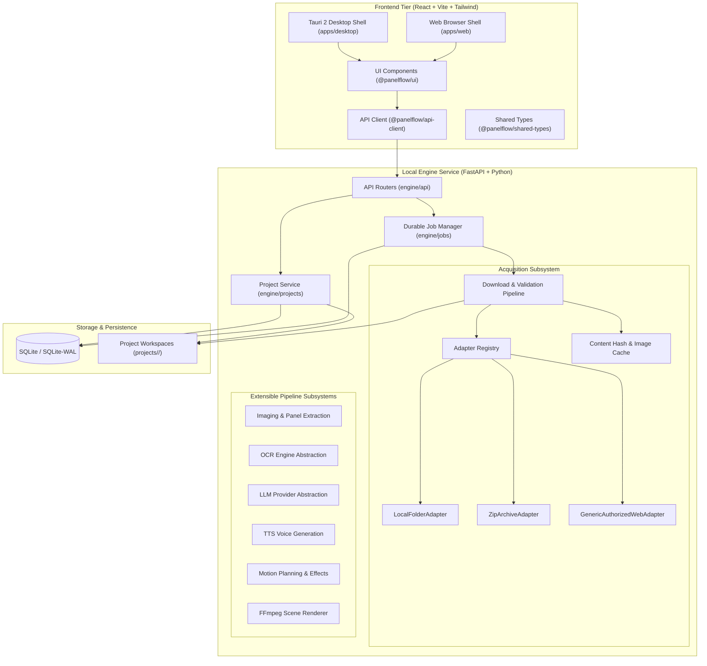
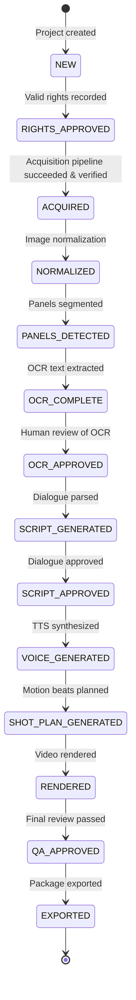

# PanelFlow Studio — System Architecture

## 1. Vision & System Overview

PanelFlow Studio is a local-first desktop application designed to convert legitimately usable comic, manga, manhua, webtoon, and illustrated story material into structured, AI-assisted motion-comic/video projects.

The architecture strictly adheres to:
- **Clean separation of concerns** (UI, API client, Engine, Adapters, Storage).
- **Desktop/Web portability**: The frontend contains zero Tauri-specific business logic and can run in any browser or desktop webview.
- **Durable, observable jobs**: Long-running acquisition and processing tasks execute asynchronously through a persistent SQLite-backed job queue with granular progress and crash recovery.
- **Strict rights validation**: Material must have explicit rights classification (`PUBLIC_DOMAIN`, `CREATIVE_COMMONS`, `LICENSED`, `USER_OWNED`, `EXPLICIT_PERMISSION`). Any work with `UNKNOWN` status cannot proceed to acquisition or downstream publication.
- **Provider-agnostic design**: Extensible plugin/adapter contracts for sources, OCR, LLM, TTS, and motion planning.



---

## 2. Module Boundaries & Repository Layout

```
panelflow/
  apps/
    desktop/             # Tauri 2 application shell & desktop bundle
    web/                 # Web application host & container entrypoint

  packages/
    ui/                  # Accessible, themeable UI components & icons
    api-client/          # Typed API client consuming engine endpoints
    shared-types/        # Shared TypeScript domain contracts & DTOs

  engine/
    api/                 # FastAPI application, CORS, static routes, routers
    config/              # Application settings, paths, limits, timeouts
    database/            # SQLAlchemy models, SQLite connection, WAL engine
    projects/            # Project service, workspace scaffolding, manifest sync
    jobs/                # Durable job system, background worker, crash recovery

    acquisition/         # Modular acquisition engine
      adapters/          # Source adapter contracts and concrete implementations
      downloader/        # Asset downloader, stream validator, rate limiter
      cache/             # SHA-256 deduplication and image cache
      rights/            # Rights status enums and validation guards
      models/            # Acquisition DTOs, page candidates, manifests

    imaging/             # Page normalization, panel detection, segmentation
    ocr/                 # OCR interfaces and multi-provider implementations
    llm/                 # LLM client abstractions (Ollama, LM Studio, etc.)
    tts/                 # TTS engine interfaces (line-by-line synthesis)
    motion/              # Shot planner and motion illustration schema
    audio/               # Audio track layout, bus routing, and SFX
    renderer/            # FFmpeg deterministic video compositor
    captions/            # Subtitle and timed dialogue generator
    qa/                  # Automated verification and quality checks
    export/              # Final render and container packager

  tests/
    unit/                # Unit tests for models, rights, adapters, ordering
    integration/         # End-to-end tests for pipelines, jobs, and APIs
    fixtures/            # Test images, zip archives, mock responses

  docs/                  # Architectural and technical documentation
```

---

## 3. Project Lifecycle

A project represents a distinct imported comic, manga, chapter, or illustrated volume.



### Rights Validation Guard
Projects initialized with `RightsStatus.UNKNOWN` are strictly forbidden from executing acquisition jobs or downstream publication. The user must explicitly declare one of:
- `PUBLIC_DOMAIN`
- `CREATIVE_COMMONS`
- `LICENSED`
- `USER_OWNED`
- `EXPLICIT_PERMISSION`

---

## 4. Durable Job System

Long-running operations (such as acquiring 100 high-resolution pages, extracting panels, or rendering video) must never block the interface or lose state upon application restarts.

### Job States
- `QUEUED`: Job created and enqueued in SQLite.
- `RUNNING`: Actively executing in the background worker pool.
- `SUCCEEDED`: All operations completed successfully.
- `FAILED`: Terminal failure encountered (error detail recorded).
- `CANCELLED`: Interrupted gracefully upon user request.

### Crash Recovery Mechanism
When the local FastAPI engine starts up:
1. It queries the `jobs` table for any jobs remaining in `RUNNING` or `QUEUED` state from an abnormal previous shutdown.
2. It transitions orphaned jobs to `FAILED` with message `"Application interrupted or crashed while job was running"` and timestamps `finished_at`.
3. Downstream assets already written to disk remain preserved. The user can inspect the partial manifest and trigger a retry without losing already verified pages.

---

## 5. Source Adapter Contract

All source ingestion is mediated by the `SourceAdapter` protocol:

```python
class SourceAdapter(Protocol):
    def can_handle(self, source: str | Path | dict) -> bool:
        """Return True if this adapter supports the given source."""
        ...

    def inspect(self, source: str | Path | dict) -> SourceInspectionResult:
        """Inspect source headers, permissions, and structure without heavy downloading."""
        ...

    def get_metadata(self, source: str | Path | dict) -> SourceMetadata:
        """Extract title, author, chapter list, and license notices."""
        ...

    def list_chapters(self, source: str | Path | dict) -> list[ChapterInfo]:
        """Enumerate available chapters/volumes."""
        ...

    def list_pages(self, chapter: ChapterInfo) -> list[PageCandidate]:
        """Discover page URLs or file paths in deterministic sequence order."""
        ...

    def download_page(self, page: PageCandidate, target_path: Path) -> DownloadedPageResult:
        """Download or copy a single page file to target_path with validation."""
        ...
```

### Phase 1 Adapters
1. **`LocalFolderAdapter`**: Imports images from a local directory using deterministic natural sorting (`1.png`, `2.png`, `10.png`).
2. **`ZipArchiveAdapter`**: Safely inspects and extracts images from `.zip` or `.cbz` archives, guarding against path traversal attacks.
3. **`GenericAuthorizedWebAdapter`**: Standard HTTP/HTTPS crawler with rate limiting, timeouts, exponential backoff retries, content-type checks, and image magic bytes verification. Optional Playwright fallback for authorized JavaScript-rendered web pages.

---

## 6. Filesystem Structure & Project Workspace

Each project is completely self-contained under the workspace root:

```
projects/<project-id>/
  project.json         # Project metadata, current stage, rights classification
  manifest.json        # Machine-readable acquisition manifest
  source/              # Validated, sequentially named source images (page_0001.jpg, etc.)
  logs/                # Detailed execution logs for diagnostics and debugging
  panels/              # (Future) Extracted panel crops
  ocr/                 # (Future) Raw and corrected OCR JSON
  story/               # (Future) Structured script and speaker assignments
  audio/               # (Future) Voice lines, music, sound effects
  motion/              # (Future) Shot plans and camera instructions
  renders/             # (Future) Rendered intermediate scene clips
  export/              # (Future) Master video file and caption tracks
```

---

## 7. Database Model Overview

The local engine uses SQLite with **Write-Ahead Logging (WAL)** mode for robust concurrent access between FastAPI request handlers and background worker tasks.

### Core Tables
1. **`projects`**:
   - `id` (VARCHAR UUID PK)
   - `title` (VARCHAR)
   - `source_type` (VARCHAR)
   - `source_url` (VARCHAR nullable)
   - `source_metadata` (JSON)
   - `rights_status` (VARCHAR)
   - `license_info` (TEXT)
   - `workspace_path` (VARCHAR)
   - `current_stage` (VARCHAR)
   - `settings` (JSON)
   - `created_at`, `updated_at` (DATETIME)

2. **`pages`**:
   - `id` (VARCHAR UUID PK) — stable relational ID
   - `project_id` (VARCHAR FK -> projects.id)
   - `sequence` (INTEGER) — deterministic reading order
   - `filename` (VARCHAR)
   - `source_url` (VARCHAR nullable)
   - `content_type` (VARCHAR)
   - `width`, `height` (INTEGER)
   - `byte_size` (BIGINT)
   - `sha256` (VARCHAR)
   - `status` (VARCHAR: READY, FAILED)
   - `error_message` (TEXT nullable)
   - `downloaded_at` (DATETIME)

3. **`jobs`**:
   - `job_id` (VARCHAR UUID PK)
   - `project_id` (VARCHAR FK -> projects.id)
   - `job_type` (VARCHAR)
   - `status` (VARCHAR: QUEUED, RUNNING, SUCCEEDED, FAILED, CANCELLED)
   - `progress` (FLOAT: 0.0 - 1.0)
   - `message` (TEXT)
   - `input` (JSON)
   - `output` (JSON)
   - `error` (TEXT nullable)
   - `created_at`, `started_at`, `finished_at` (DATETIME)

4. **`page_normalizations`**:
   - `id` (VARCHAR UUID PK)
   - `project_id` (VARCHAR FK -> projects.id)
   - `page_id` (VARCHAR FK -> pages.id)
   - `source_sha256` (VARCHAR)
   - `normalized_sha256` (VARCHAR)
   - `source_width`, `source_height` (INTEGER)
   - `normalized_width`, `normalized_height` (INTEGER)
   - `color_space` (VARCHAR: sRGB)
   - `orientation` (INTEGER)
   - `operations` (JSON structured audit log)
   - `status` (VARCHAR: NORMALIZED, FAILED)
   - `created_at` (DATETIME)

5. **`panels`**:
   - `id` (VARCHAR UUID PK)
   - `project_id` (VARCHAR FK -> projects.id)
   - `page_id` (VARCHAR FK -> pages.id)
   - `sequence_global` (INTEGER)
   - `sequence_page` (INTEGER)
   - `x`, `y`, `width`, `height` (INTEGER, original page space)
   - `normalized_x`, `normalized_y`, `normalized_width`, `normalized_height` (FLOAT 0.0 - 1.0)
   - `detection_method` (VARCHAR: CONTOUR, GOBIG, MANUAL, FALLBACK)
   - `confidence` (FLOAT)
   - `panel_type` (VARCHAR: STANDARD, SPLASH, INSET, BORDERLESS, WEBTOON_SEGMENT, FULL_PAGE, UNKNOWN)
   - `status` (VARCHAR: DETECTED, CONFIRMED, NEEDS_REVIEW, IGNORED)
   - `manually_modified` (BOOLEAN)
   - `created_at`, `updated_at` (DATETIME)

6. **`text_regions`**:
   - `id` (VARCHAR UUID PK)
   - `project_id` (VARCHAR FK -> projects.id)
   - `page_id` (VARCHAR FK -> pages.id)
   - `panel_id` (VARCHAR FK -> panels.id)
   - `sequence_in_panel` (INTEGER)
   - `sequence_global` (INTEGER)
   - `x`, `y`, `width`, `height` (INTEGER, panel-relative crop space)
   - `normalized_x`, `normalized_y`, `normalized_width`, `normalized_height` (FLOAT 0.0 - 1.0)
   - `page_x`, `page_y`, `page_width`, `page_height` (INTEGER, page-absolute canvas space)
   - `polygon_json` (JSON polygon contour)
   - `region_type` (VARCHAR: SPEECH, NARRATION, THOUGHT, SFX, CAPTION, UNKNOWN)
   - `reading_direction` (VARCHAR: ltr, rtl, vertical, auto)
   - `detection_method` (VARCHAR: AUTO, MANUAL, FALLBACK)
   - `detection_confidence` (FLOAT)
   - `status` (VARCHAR: DETECTED, CONFIRMED, NEEDS_REVIEW, REJECTED)
   - `raw_text`, `raw_confidence`, `raw_polygon_json` (Layer 1: Immutable Machine OCR)
   - `ocr_engine`, `ocr_engine_version`, `ocr_extracted_at` (Layer 1: Provenance)
   - `corrected_text`, `corrected_by`, `correction_status`, `corrected_at` (Layer 2: Human Canonical Content)
   - `speaker_character_id`, `speaker_confidence`, `speaker_assignment_method` (Layer 3: Downstream Preparation)
   - `reading_order_in_panel` (INTEGER, deprecated alias)
   - `created_at`, `updated_at` (DATETIME)

7. **`ocr_records`**:
   - Whole-panel fallback OCR table retained for backward compatibility when region extraction is bypassed.

8. **`ocr_cache`**:
   - `cache_key` (VARCHAR SHA256 PK)
   - `crop_sha256` (VARCHAR)
   - `engine_id`, `engine_version` (VARCHAR)
   - `language` (VARCHAR)
   - `settings_hash` (VARCHAR)
   - `result_json` (JSON cached OCR payload)
   - `created_at` (DATETIME)

---

## 8. Desktop / Web Migration Path

PanelFlow Studio is structured to transition smoothly to a cloud or multi-tenant web environment without rewriting the core processing engine:

| Component | Desktop (Phase 1) | Web / Cloud (Future) |
|---|---|---|
| **Frontend UI** | React + Vite in Tauri 2 Webview | React + Vite hosted on CDN / Nginx |
| **Frontend API** | `http://127.0.0.1:8765` via `@panelflow/api-client` | Reverse proxy `/api` via `@panelflow/api-client` |
| **Engine Runtime** | Local FastAPI process | Containerized FastAPI (Docker/Kubernetes) |
| **Worker Queue** | Local SQLite job queue + Asyncio task pool | Redis + Celery / Dramatiq / Temporal |
| **Authentication** | Single local user / OS permission | JWT / OAuth2 / Multi-tenant RBAC |

---

## 9. Local Engine Lifecycle & Desktop Hardening (Phase 1.5)

In desktop production operation:
- The Tauri application shell (`apps/desktop/src-tauri/src/main.rs`) manages the Python FastAPI engine process automatically.
- **Port-Lock & Single-Instance Check**: Before launching, the desktop checks if port `8765` is already listening. If an instance is already alive, Tauri connects immediately without spawning duplicates.
- **Automatic Process Spawning**: If the port is unbound, Tauri spawns `python run_engine.py` in the background as a managed child process.
- **Health Polling & Fail-Safe UI**: The desktop frontend polls `/api/system/health`. If the engine is unreachable or crashes, the UI presents an informative "Processing engine unavailable" screen with a **Retry Engine Connection** action rather than silently crashing.
- **Clean Child Termination**: When the user closes the Tauri window, the Rust runtime intercepts `RunEvent::Exit` and cleanly terminates the spawned Python engine process, avoiding orphaned background tasks.

---

## 10. Page Normalization Subsystem

To guarantee non-destructive operation, original acquisitions in `source/` are strictly immutable:
1. **Pipeline Derivative**: Normalized derivatives are written to `normalized/page_XXXX.jpg`.
2. **Transformations**:
   - EXIF orientation auto-rotation (`ImageOps.exif_transpose`).
   - Alpha channel flattening onto pure white backing paper.
   - Color space normalization to sRGB.
   - Long webtoon aspect ratio classification (`height >= 4000` or `aspect >= 2.5`).
   - Resolution normalization to working scale (default 1920px width).
3. **Structured Persistence**: Stored in `page_normalizations` with source SHA-256, normalized SHA-256, dimensions, and operational flags.

---

## 11. Canonical Panel & Reading Order Subsystem

Extracts, structures, and persists comic panel bounding boxes:
- **`PanelRecord` Entity**: Stable UUIDs, dual coordinates (source pixels + normalized `0.0..1.0`), panel types (`STANDARD`, `SPLASH`, `INSET`, `BORDERLESS`, `WEBTOON_SEGMENT`), and review statuses (`DETECTED`, `CONFIRMED`, `NEEDS_REVIEW`, `IGNORED`).
- **Detection Engine**: `ContourPanelDetector` using polarity-aware gutter sampling, Canny edge detection, morphological line bridging, nested contour filtering, and webtoon strip tiling.
- **Reading Order**: Configurable `ltr`, `rtl`, `vertical`, or `auto` with row-clustering vertical tolerance. Maintains both `sequence_page` and `sequence_global`.
- **Review UI**: Interactive SVG canvas in React with drag, resize, split (horizontal/vertical), merge, and bottom sequence timeline.

---

## 12. Text Region Subsystem & 3-Layer OCR Architecture

Bridges panel segmentation and character-level dialogue adaptation:
- **Speech Balloon & Text Detection**: `ClassicalTextRegionDetector` isolates high-luminance speech balloons, sharp caption boxes, and onomatopoeia strokes within each panel crop, outputting panel-relative and page-absolute bounding boxes with guaranteed full-panel fallback.
- **3-Layer Provenance Separation**:
  - **Layer 1 (Machine OCR)**: Immutable machine transcripts (`raw_text`, `raw_confidence`, `ocr_engine`, `ocr_extracted_at`). Strictly read-only for mathematical reproducibility.
  - **Layer 2 (Human Correction)**: Canonical content (`corrected_text`, `corrected_by`, `correction_status`). Editable in the UI; preserves machine ground truth in Layer 1.
  - **Layer 3 (Speaker Attribution)**: Prepares character mapping (`speaker_character_id`, `speaker_confidence`, `speaker_assignment_method`) for Milestone 4 character registry without baking in hardcoded assumptions.
- **Content-Addressed OCR Cache**: SHA-256 keyed cache preventing redundant GPU/CPU passes across identical image crops.
- **Strict Approval Gate**: `POST /api/projects/{id}/ocr/confirm` rejects approval with HTTP 400 if any region remains in `NEEDS_REVIEW` status (< 0.70 confidence, empty, or unconfirmed).
- **Downstream Export Contract**: Canonical JSON endpoint (`GET /api/projects/{id}/export/contract`) delivers project, pages, panels, text regions, raw OCR, human corrections, and speaker hooks for Milestone 4 ingestion.

---

## 13. Story Understanding & Narrative IR Subsystem (Milestone 4 - Layer B)

Derives grounded semantic narrative interpretations from approved human-reviewed material:
- **3-Truth-Layer Separation**:
  - **Layer A (Source Truth)**: Immutable pages, panels, text regions, and raw/corrected OCR.
  - **Layer B (Narrative Interpretation)**: Re-generable `NarrativeDocument`, characters, locations, scenes, beats, and utterances with provenance.
  - **Layer C (Adaptation)**: Video presentation script (`VideoScript`, `ScriptSegment`s). Never pollutes Layer A or B.
- **Provider Abstraction**: Extensible `LLMProvider` base (`generate_text`, `generate_structured` with schema repair, `analyze_vision`) supporting Mock, local Ollama (`qwen3.5`, `gemma4`), and OpenAI-compatible endpoints (`LMStudio`).
- **Deterministic Balloon Geometry**: Runs spatial balloon tail vector and solitary character heuristics first, eliminating >70% of LLM calls cheaply and deterministically.
- **Character Registry & Disambiguation**: Tracks canonical identities, aliases, and visual traits with interactive merge and split operations.
- **Continuity Audit**: Automated detection of duplicate identities, invalid speakers, and sequence misorders.

---

## 14. Video Script Adaptation Subsystem (Milestone 4 - Layer C)

Adapts Narrative IR into timed, spoken presentation formats:
- **Adaptation Profiles**: `FAITHFUL`, `CONDENSED`, `DRAMATIC_NARRATION`, and `ACCESSIBLE_RECAP`.
- **Duration & Pacing Estimation**: Deterministic WPM calculation (Narration 150 WPM, Dialogue 135 WPM) with cadence pauses (commas, periods, ellipses) and clamps.
- **Faithfulness Validator**: Evaluates every line as `SUPPORTED`, `WEAKLY_SUPPORTED`, or `UNSUPPORTED` to prevent and flag hallucinations.
- **Strict Approval Gate**: Enforces approval before downstream motion and audio planning (`SCRIPT_APPROVED`).
- **Non-Goals Enforced**: Zero audio generation, zero voice cloning, zero music synthesis, and zero FFmpeg rendering in Milestone 4.


