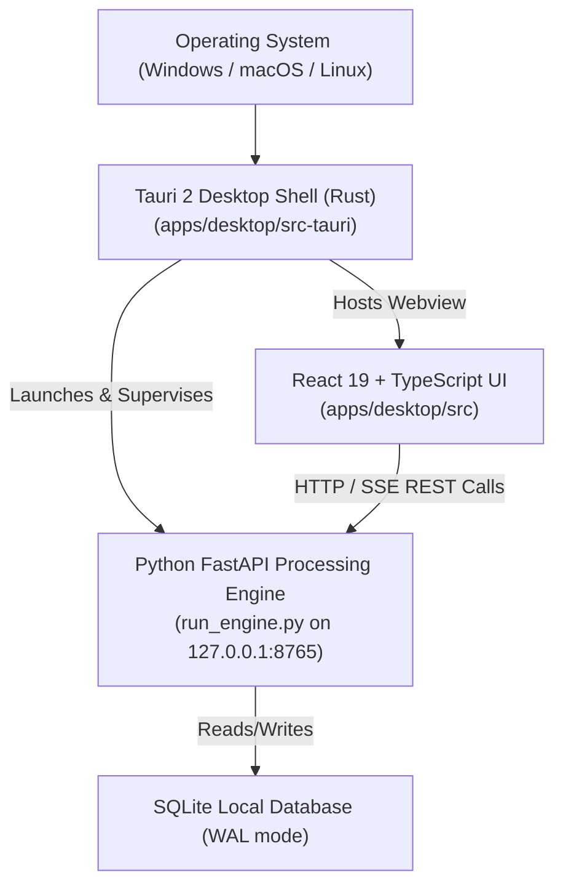

# Desktop Shell & Engine Lifecycle Management

PanelFlow Studio operates as a local-first desktop application. The end user never needs to open a terminal or manually run `python run_engine.py`. The native desktop shell autonomously supervises the Python processing engine throughout the application lifecycle.

---

## 1. Architecture Overview



---

## 2. Engine Manager Implementation (`main.rs`)

The Rust native core (`apps/desktop/src-tauri/src/main.rs`) manages the backend process via an `EngineManager` struct:

### Key Responsibilities

1. **Path Resolution via Ancestor Traversal**:
   - Searches current directory and walks up to 5 parent directories to locate `run_engine.py`.
   - Also checks standard system and virtual environment Python binaries (`python`, `python3`, `.venv/Scripts/python.exe`).
2. **Port Conflict Check (Port 8765)**:
   - Before attempting to spawn a new process, the engine manager attempts a TCP connection to `127.0.0.1:8765`.
   - If an engine instance is already healthy, it adopts the running instance to avoid port binding errors (`WinError 10048`).
3. **Background Daemon Flags**:
   - On Windows, spawns the child process with `CREATE_NO_WINDOW (0x08000000)` so no secondary console window flashes on screen.
4. **Health Check Synchronization**:
   - Loops for up to 15 seconds querying `http://127.0.0.1:8765/api/system/health`.
   - As soon as HTTP 200 is returned, the frontend webview is shown.
5. **Clean Process Termination**:
   - Listens to Tauri's `RunEvent::Exit` event.
   - Sends termination signal to the child PID, killing any spawned Python subprocess tree cleanly.

---

## 3. UI Disconnection & Heartbeat Monitoring (`App.tsx`)

The React frontend maintains a persistent health polling loop:

- **Heartbeat Interval**: Checks `api.checkHealth()` every 5 seconds.
- **Visual Feedback**:
  - Top header indicator turns emerald green when connected: `Local Engine v0.1.0`.
  - Turns red when offline: `Engine Offline`.
- **Fault Tolerance**:
  - If the engine crashes or is terminated by the user, the UI immediately displays a dedicated full-screen alert: **"Processing engine unavailable"**.
  - A **"Retry Engine Connection"** button allows instant reconnection without reloading the application.

---

## 4. Production Release Bundles Verified

PanelFlow Studio desktop has been built and verified in release configuration:

| Artifact | Format | Output Path | File Size | Status |
|---|---|---|---|---|
| **Standalone Executable** | `.exe` | `apps/desktop/src-tauri/target/release/panelflow-desktop.exe` | 8.84 MiB | **PASS** |
| **WiX Windows Installer** | `.msi` | `apps/desktop/src-tauri/target/release/bundle/msi/PanelFlow Studio_0.1.0_x64_en-US.msi` | 2.76 MiB | **PASS** |
| **NSIS Windows Setup** | `.exe` | `apps/desktop/src-tauri/target/release/bundle/nsis/PanelFlow Studio_0.1.0_x64-setup.exe` | 1.84 MiB | **PASS** |

### Build Commands

```bash
# Compile and build Tauri release without installer
npm run tauri -- build --no-bundle

# Compile complete Windows production installers (MSI + NSIS)
npm run tauri -- build
```
