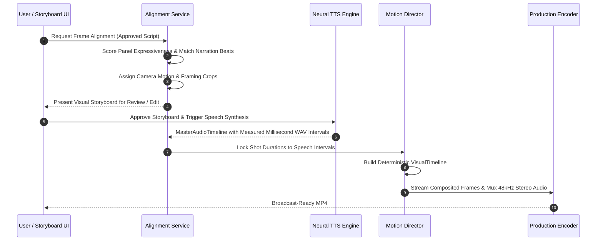

# Narration-to-Frame Alignment & Visual Storyboard Architecture

## 1. Overview

A critical flaw of standard AI video tools is the **slideshow effect**: presenting an arbitrary sequence of static panels with uniform duration, irrespective of speech cadence or dramatic emphasis. 

The **PanelFlow Narration-to-Frame Alignment Engine** bridges approved storyteller narration with the visual comic panels by:
1. Dynamically selecting the most expressive panels that match the spoken story beat.
2. Subdividing long narration intervals across multiple supporting panels without cutting audio.
3. Locking shot durations directly to authoritative neural TTS speech lengths.
4. Providing an interactive, editable two-pane Storyboard UI (Manga visual on the left, Spoken narration on the right).



---

## 2. Intelligent Frame Selection Criteria

Rather than forcing every detected comic panel into the video, the alignment engine filters and prioritizes panels based on semantic storytelling relevance:

- **Establishing & Environment Shots** ($3.0s - 6.0s$): Selected for scene introduction or major location shifts. Uses slow pan or subtle push-in (`SLOW_PUSH`).
- **Reaction Close-Ups** ($1.5s - 3.0s$): High-intensity emotional expressions (shock, anger, contemplation) matched to dialogue beats or plot reveals. Uses `REACTION_CLOSEUP` or `CHARACTER_FOCUS`.
- **Action & Climax Beats** ($2.0s - 4.5s$): Kinetic combat maneuvers or magical manifestations. Uses `IMPACT` or dynamic shake effects.
- **Transitional Panels**: Bounded cross-dissolves or soft wipes (`CROSS_DISSOLVE`, duration $0.3s - 0.6s$).
- **Filtered Elements**: Pure promotional panels, credit banners, donation watermarks, and duplicate reaction shots are pruned from the primary timeline.

---

## 3. Data Contract: Aligned Storyboard Segment

Every aligned narration beat produces a structured storyboard record:

```json
{
  "segment_id": "seg_a7f9201c",
  "scene_id": "scene_02",
  "text": "Inside the secluded manor, the elders traded cautious glances, unaware that every secret was already laid bare.",
  "emotion": "TENSE",
  "intensity": 0.75,
  "audio_clip_path": "audio/dialogue/dialogue_002_a7f9201c.wav",
  "measured_duration_sec": 6.84,
  "supporting_panels": [
    {
      "panel_id": "panel_005",
      "reading_order": 5,
      "role": "ESTABLISHING",
      "crop_bounds": { "x": 0.05, "y": 0.12, "width": 0.90, "height": 0.42 },
      "sub_duration_sec": 3.42,
      "camera_motion": {
        "type": "SLOW_PUSH",
        "start_zoom": 1.0,
        "end_zoom": 1.08,
        "easing": "EASE_IN_OUT"
      }
    },
    {
      "panel_id": "panel_006",
      "reading_order": 6,
      "role": "REACTION_CLOSEUP",
      "crop_bounds": { "x": 0.45, "y": 0.58, "width": 0.52, "height": 0.38 },
      "sub_duration_sec": 3.42,
      "camera_motion": {
        "type": "CHARACTER_FOCUS",
        "start_zoom": 1.05,
        "end_zoom": 1.05,
        "easing": "LINEAR"
      }
    }
  ],
  "music_cue": {
    "intent": "TENSE",
    "ducking_gain_db": -14.0
  },
  "sfx_cue": {
    "type": "subtle_wind_chime",
    "offset_sec": 1.2
  }
}
```

---

## 4. Multi-Panel Sub-Timeline Synchronization

When a single continuous narration sentence spans multiple panels:
$$\text{Narration Interval } I = [t_{\text{start}}, t_{\text{end}}] \quad \text{with duration } D = t_{\text{end}} - t_{\text{start}}$$
If $K$ panels $\{P_1, P_2, \dots, P_K\}$ are mapped to this segment:
- The spoken audio file remains **one single contiguous track** to avoid artificial vocal stutter or click artifacts.
- The visual clock is divided proportionally across the $K$ panels:
  $$\Delta t_k = \frac{w_k}{\sum_{j=1}^K w_j} \cdot D$$
  *(where $w_k$ is weighted by visual complexity and panel aspect ratio).*
- Transitions between sub-panels use zero-latency cut or fast dissolve ($0.25s$), ensuring perfect audio/visual lockstep.

---

## 5. Visual Storyboard UI Workflow

The user can inspect and adjust the alignment before final rendering:
- **Left Column**: High-resolution cropped manga frame preview with pan/zoom keyframe guides and interactive bounding box adjustment.
- **Right Column**: Spoken narration text, emotional inflection selector, measured duration readout, and audio waveform preview.
- **Controls**:
  - `[Change Panel]` / `[Add Frame to Beat]`: Adjust which comic frames accompany this sentence.
  - `[Split Beat]`: Splits a long narration beat across two independent sentences and panels.
  - `[Merge Beat]`: Combines two adjacent sentences into one continuous voiceover.
  - `[Re-Generate Voice]`: Re-synthesizes speech for only this segment without touching other approved takes.
