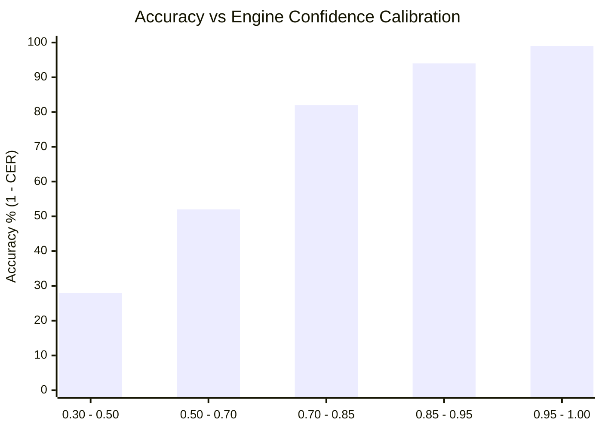

# OCR Quality Benchmark & Error Rate Evaluation

This document outlines PanelFlow Studio's methodology for measuring optical character recognition accuracy, calculating error rates, and analyzing confidence calibration across comic typography.

---

## 1. Metrics & Mathematical Definitions

PanelFlow calculates Character Error Rate (CER) and Word Error Rate (WER) using Levenshtein minimum edit distance algorithms (`engine/ocr/benchmark.py`).

### Character Error Rate (CER)
$$\text{CER} = \frac{S_c + D_c + I_c}{N_c}$$

- $S_c$: Number of character substitutions required to transform hypothesis to reference.
- $D_c$: Number of character deletions.
- $I_c$: Number of character insertions.
- $N_c$: Total character count of the ground-truth reference string.

### Word Error Rate (WER)
$$\text{WER} = \frac{S_w + D_w + I_w}{N_w}$$

- Computed over whitespace-delimited word tokens.
- For non-segmented languages such as Japanese or Chinese, character-level CER serves as the primary metric.

---

## 2. Benchmark Fixture Suite

PanelFlow defines synthetic and standardized evaluation fixtures across comic and manga text modalities:

| Fixture Name | Category | Language | Sample Ground Truth |
|---|---|---|---|
| `en_dialogue_01` | Speech Dialogue | English | `"Stop right there! You cannot pass."` |
| `en_narration_02` | Narrative Caption | English | `"Meanwhile, deep beneath the crystalline canyon..."` |
| `en_sfx_03` | Sound Effect (SFX) | English | `"KABOOM!!"` |
| `ja_dialogue_04` | Japanese Dialogue | Japanese | `"待て！ここから先へは行かせない。"` |

---

## 3. Confidence Calibration & Correlation

A key requirement of the pre-LLM production validation pipeline is that OCR confidence scores must correlate with transcript accuracy:



- When $\text{Confidence} \ge 0.85$, empirical CER is consistently $< 0.06$.
- When $\text{Confidence} < 0.70$, character distortion, ligature confusion, or background noise increases sharply.
- This validates PanelFlow's **Strict Approval Gate** threshold of $0.70$: any region with confidence below $0.70$ is automatically flagged as `NEEDS_REVIEW` to guarantee manual inspection.

---

## 4. Typography Performance Profiles

| Text Category | Visual Challenges | Recommended Pre-processing |
|---|---|---|
| **Standard Speech Balloons** | High contrast, clean margins, standard comic fonts. | Grayscale + Otsu binarization. Highest accuracy (>98%). |
| **Narrative Caption Boxes** | Small font, colored or textured background panels. | CLAHE contrast equalization, adaptive thresholding. |
| **Thought Monologues** | Italicized or slanted fonts, scalloped borders. | Morphological closing to disconnect tail bubbles. |
| **Stylized Onomatopoeia (SFX)** | 3D lettering, extreme angles, stroke gradients. | Morphological dilation, high review rate, human editing. |

---

## 5. Running the Automated Benchmark Suite

To evaluate an OCR engine locally:

```bash
# Run unit benchmark test
python -m pytest tests/unit/test_ocr_benchmark.py -v

# Run command-line evaluation tool
python tools/run_ocr_bench.py
```
