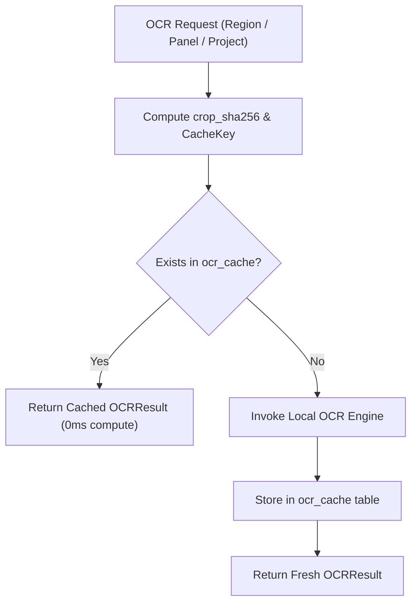

# OCR Engine Architecture & Pipeline

PanelFlow Studio features a modular, deterministic, multi-tiered OCR pipeline designed to reliably transcribe comic and manga dialogue into structured, reviewable text regions before any language model is permitted to reason about the project.

---

## 1. Modular Provider Registry

All OCR engines implement the `BaseOCREngine` abstract base class (`engine/ocr/base.py`):

```python
class BaseOCREngine(ABC):
    @property
    @abstractmethod
    def engine_id(self) -> str:
        """Unique identifier (e.g. 'mock_ocr', 'windows_media', 'paddleocr')."""
        pass

    @abstractmethod
    def extract_text(
        self,
        image_path: Path | str,
        panel_id: str | None = None,
        language: str = "en",
        **kwargs,
    ) -> OCRResult:
        """Extract text blocks, bounding boxes, and confidence scores."""
        pass
```

### Supported & Prepared Providers

1. **`mock_ocr` (Built-in / Offline Fallback)**:
   - High-speed deterministic generator used for automated QA, E2E validation, and offline development.
   - Generates synthetic speech bubbles with reproducible confidence scores.
2. **`windows_media` (Windows 10/11 Native)**:
   - Zero-dependency local OCR leveraging the Windows `Windows.Media.Ocr` WinRT runtime.
   - Extremely fast, hardware-accelerated, and requires zero external Python wheel bloat.
3. **`paddleocr` / `tesseract` (Extensible Local Providers)**:
   - Ready for multi-language Japanese vertical manga and Chinese manhua via modular plugin adapters.

---

## 2. Deterministic Content-Addressed OCR Cache

To eliminate redundant GPU/CPU compute when re-running extraction or adjusting bounding boxes, PanelFlow enforces content-addressed caching in SQLite (`OCRCacheRecord`):

### Cache Key Computation
$$\text{CacheKey} = \text{SHA256}(\text{crop\_sha256} + \text{":"} + \text{engine\_id} + \text{":"} + \text{engine\_version} + \text{":"} + \text{language} + \text{":"} + \text{settings\_hash})$$

- `crop_sha256`: Cryptographic hash of the cropped text region image bytes.
- `settings_hash`: Normalized SHA256 of engine hyperparameters (binarization, PSM mode).

### Cache Hit Workflow


---

## 3. Granular Execution Levels

PanelFlow supports three distinct tiers of OCR execution:

1. **Region-Level Extraction** (`POST /api/projects/{id}/text-regions/{region_id}/ocr`):
   - Transcribes a single isolated balloon crop.
   - Used during interactive editing when an editor redraws a box or switches OCR engines.
2. **Panel-Level Extraction** (`POST /api/projects/{id}/panels/{panel_id}/ocr`):
   - Transcribes all text regions within a single comic panel in reading order.
3. **Project-Level Extraction** (`POST /api/projects/{id}/ocr/extract`):
   - Asynchronous background job via `JobManager` with real-time SSE / polling progress telemetry.
   - Automatically iterates through all panels and pages.

---

## 4. OCR Quality Check & The Strict Approval Gate

PanelFlow strictly forbids unverified machine transcripts from entering Milestone 4 (Story Understanding & Script Generation).

### Quality Thresholds
- **Confidence Check**: Any text region with $\text{confidence} < 0.70$ is automatically flagged with `status="NEEDS_REVIEW"`.
- **Empty / Ambiguous Check**: Regions where OCR returns empty strings or low character densities are marked `NEEDS_REVIEW`.
- **Classification Check**: Regions detected as `UNKNOWN` require manual human confirmation.

### The Strict Approval Gate (`POST /api/projects/{id}/ocr/confirm`)

The approval endpoint executes atomic validation checks before allowing project stage transition:

```python
# Gate 1: Ensure panels exist
panels = db.query(PanelRecord).filter(PanelRecord.project_id == project_id).all()
if not panels:
    raise ValueError("Cannot approve OCR: No panels detected or confirmed in project.")

# Gate 2: Strict rejection of any unresolved NEEDS_REVIEW regions
unresolved_regions = db.query(TextRegionRecord).filter(
    TextRegionRecord.project_id == project_id,
    TextRegionRecord.status == "NEEDS_REVIEW",
).all()

if unresolved_regions:
    raise ValueError(
        f"Cannot approve OCR: {len(unresolved_regions)} text regions have 'NEEDS_REVIEW' status. "
        f"Please review or confirm low-confidence regions before approval."
    )

record.current_stage = PipelineStage.OCR_APPROVED.value
```

If any region remains flagged, the server returns **HTTP 400 Bad Request**, displaying the exact count of unresolved regions in the desktop UI. Only when all regions are marked `CONFIRMED` or `REJECTED` will the project advance to `OCR_APPROVED`.
