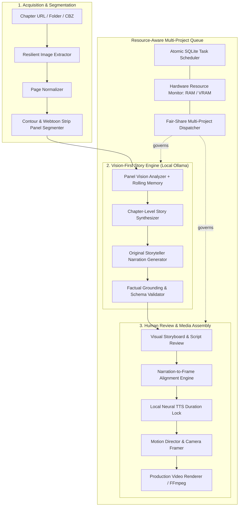

# Ollama Narration Architecture & Vision-First Manga Storytelling

## 1. Executive Summary

PanelFlow Studio is an AI-assisted motion comic production platform that transforms manga and manhua into cinematographic, narrated motion videos. This document defines the **Ollama Narration Architecture**, establishing a local-first, vision-grounded storytelling pipeline that replaces simplistic OCR-slideshow mechanics with genuine narrative comprehension and multi-project resource governance.

---

## 2. Core Architectural Principles

1. **Vision-First Grounding Over Verbatim Transcription**:
   Narration is an original dramatic retelling derived from visual character actions, expressions, and environments. OCR is strictly supplemental evidence (e.g., character names, signs, magic incantations) and is never copied word-for-word into voiceover.

2. **Chapter-Level Memory and Continuous Context**:
   Panels are not analyzed in isolation. An incremental story state tracks:
   - Active characters and their visual signatures
   - Inferred relationships and allegiances
   - Current location and environment
   - Ongoing conflict, goals, and revelations
   - Unresolved narrative tension and cliffhangers

3. **Strict Structural Validation & Schema Guardrails**:
   Every LLM output adheres to deterministic Pydantic schemas. Untrusted model output is verified against real database IDs (panels, scenes, characters) before acceptance. Malformed outputs trigger structured repair prompts with bounded retries.

4. **Resource-Aware Local Model Discipline**:
   GPU memory is protected. Ollama inference requests are governed by a hardware admission controller defaulting to sequential execution (1 active inference request) with dynamic telemetry monitoring RAM, VRAM, and loaded model footprints.

---

## 3. The 4-Stage Story Generation Pipeline

### Stage A: Panel Vision Analysis (`PanelVisionAnalyzer`)
- **Input**: Ordered crop of panel $P_i$, supplemental OCR text, preceding story memory $M_{i-1}$.
- **Operation**: Multimodal LLM inspection via `POST /api/generate` with base64 image bytes and JSON schema enforcement.
- **Output**: Visual description of clothing, hair, poses, actions, environment, emotional intensity, content classification (`story`, `cover`, `advertisement`, `credits`), and an updated story memory delta $\Delta M_i$.
- **Caching**: Checkpointed by SHA-256 of raw image bytes, model metadata, and prior context digest.

### Stage B: Chapter Story Reconstruction (`ChapterStoryReasoner`)
- **Input**: Complete sequence of verified story panel observations $\{O_1, O_2, \dots, O_N\}$ and accumulated memory $M_N$.
- **Operation**: Synthesizes the overall narrative arc:
  - Consolidates recurring characters into a chapter registry with visual signatures.
  - Groups panels into 3–8 logical scenes with coherent dramatic boundaries.
  - Defines 6–16 high-level story beats citing actual panel IDs.
  - Identifies central conflicts, secrets, revelations, and cliffhangers.
- **Output**: Canonical `NarrativeDocument` persisted in SQLite.

### Stage C: Original Storyteller Narration (`NarrationGenerator`)
- **Input**: Approved `NarrativeDocument`, requested tone profile (Cinematic, Dramatic, Fast Recap), and language.
- **Operation**: Crafts original spoken prose that interprets and contextualizes the visual scene without quoting dialogue bubbles.
- **Output**: Array of `NarratorBeat` items linking narration text to scene IDs and supporting panel subsets.

### Stage D: Grounding & Validation Gate (`GroundingValidator`)
- **Check 1 (Coverage)**: All chapter scenes must be addressed in sequential reading order.
- **Check 2 (Reference Integrity)**: Every referenced panel ID must exist within the parent scene boundary.
- **Check 3 (No Hallucinated Names)**: Character canonical names must have evidentiary backing from dialog or official metadata; otherwise descriptive handles ("The Crimson Swordsman") are preserved.

---

## 4. Multi-Role Ollama Model Assignment

PanelFlow separates local model roles rather than forcing a single model to handle disparate tasks:

| Role | Typical Target Models | Critical Capability Required | Function |
|---|---|---|---|
| **Vision Analysis** | `qwen3.5:9b`, `gemma4:latest`, `qwen3.6:latest` | `vision=True` via `/api/show` | Panel visual inspection, pose/expression recognition, strip content filtering |
| **Story Reasoning** | `qwen3-coder:30b`, `qwen3.6:latest`, `qwen3.5:9b` | High context window ($\ge 16k$), structured JSON | Multi-panel story synthesis, character tracking, scene grouping |
| **Narration Writing**| `qwen3.6:latest`, `qwen3.5:9b`, `qwen3-coder:30b` | Prose fluency, dramatic pacing | Spoken narrator script, tone inflection, semantic motion tags |

---

## 5. Security & Isolation

- **Endpoint Trust**: Remote Ollama URLs are restricted to user-configured HTTP/HTTPS targets. Private network addresses are filtered against SSRF unless explicitly whitelisted.
- **Zero Local Leakage**: API tokens and credentials for remote/cloud endpoints are maintained in isolated configuration storage, never embedded in project packages or exported video artifacts.
- **Deterministic Re-runs**: All prompt templates, system instructions, and temperature parameters are versioned and stored with project metadata.
