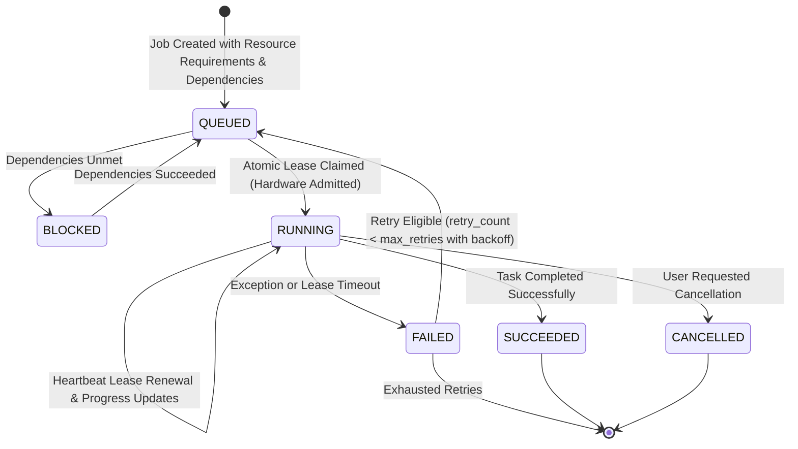

# Resource-Aware Multi-Project Job Scheduler & Queue Architecture

## 1. Problem Statement

Manga video production entails heavy compute across multiple stages:
- **I/O & Network**: Image strip downloads, CDN retries, caching.
- **CPU Bound**: Image decompression, panel contour tracing, watershed gutter segmentation.
- **GPU Bound (LLM)**: Visual panel analysis (VLM), story reasoning, narration writing.
- **GPU Bound (Audio/Video)**: Neural TTS voice synthesis (F5-TTS/CUDA), FFmpeg video encoding (NVENC / x264).

When a user works with multiple manga projects simultaneously, unmanaged background concurrency will crash the GPU due to out-of-memory (OOM) errors, corrupt SQLite databases, or cause severe UI freezing.

The **PanelFlow Persistent Multi-Project Scheduler** solves this through durable SQLite persistence, atomic worker claiming with leases, fair-share multi-project scheduling, explicit task dependencies, and a hardware resource admission controller.

---

## 2. Scheduler Architecture & State Machine



---

## 3. SQLite Database Schema Extensions

The `jobs` table is extended to support durable scheduling across projects:

```sql
ALTER TABLE jobs ADD COLUMN priority INTEGER DEFAULT 0;
ALTER TABLE jobs ADD COLUMN depends_on_job_id VARCHAR(36) NULL;
ALTER TABLE jobs ADD COLUMN requires_gpu BOOLEAN DEFAULT 0;
ALTER TABLE jobs ADD COLUMN gpu_vram_mb FLOAT DEFAULT 0.0;
ALTER TABLE jobs ADD COLUMN cpu_units INTEGER DEFAULT 1;
ALTER TABLE jobs ADD COLUMN worker_lease_id VARCHAR(36) NULL;
ALTER TABLE jobs ADD COLUMN lease_expires_at DATETIME NULL;
ALTER TABLE jobs ADD COLUMN retry_count INTEGER DEFAULT 0;
ALTER TABLE jobs ADD COLUMN max_retries INTEGER DEFAULT 3;
```

### Table Definitions

| Column | Type | Description |
|---|---|---|
| `job_id` | `VARCHAR(36)` | Unique UUID identifier for the task |
| `project_id` | `VARCHAR(36)` | Owning project foreign key |
| `job_type` | `VARCHAR(64)` | `ACQUISITION`, `PANEL_DETECTION`, `STORY_ANALYSIS`, `SCRIPT_GENERATION`, `AUDIO_GENERATION`, `MOTION_PLANNING`, `RENDER` |
| `priority` | `INTEGER` | Higher integer runs first (e.g. interactive re-generations priority = 10, batch imports = 0) |
| `depends_on_job_id`| `VARCHAR(36)` | Job ID that must reach `SUCCEEDED` before this job can be claimed |
| `requires_gpu` | `BOOLEAN` | Whether this job requires GPU / Ollama admission |
| `gpu_vram_mb` | `FLOAT` | Estimated VRAM headroom required (e.g., 6000 MB for 9B VLM, 1400 MB for TTS) |
| `worker_lease_id` | `VARCHAR(36)` | UUID of the executing worker instance |
| `lease_expires_at` | `DATETIME` | Heartbeat timestamp. If exceeded, job is considered abandoned and recovered |
| `retry_count` | `INTEGER` | Current retry attempt number |
| `max_retries` | `INTEGER` | Maximum retry attempts with bounded exponential backoff ($2^n \times 1.5s$) |

---

## 4. Hardware Resource Admission Controller

The resource manager inspects local system telemetry before admitting GPU-intensive jobs:

1. **System Memory**: Reads total and available RAM via `psutil.virtual_memory()`. Requires $\ge 1.5\text{ GB}$ available RAM for image and audio processing.
2. **GPU VRAM**: Reads total, free, and used VRAM using `nvidia-smi` subprocess or PyTorch CUDA properties.
3. **Active Ollama Telemetry**: Queries `GET /api/ps` to determine currently loaded models, active contexts, and allocated VRAM in Ollama.
4. **Inference Concurrency**:
   - **Default**: Exactly **1 active GPU inference request** across all projects.
   - **Automatic Mode**: Allows concurrency $= 2$ only if measured free VRAM exceeds $8000\text{ MB}$ and GPU utilization is below $75\%$.
   - **Manual Mode**: User explicitly sets concurrency limit ($1, 2, \text{or } 4$).

---

## 5. Multi-Project Fair Scheduling Algorithm

To prevent Project A (e.g. a 100-page chapter) from starving Project B (e.g. a short 10-page chapter):

1. **Active Project Interleaving**:
   The dispatcher groups pending jobs by `project_id`. When multiple projects have eligible jobs ready in `QUEUED` state, the scheduler dispatches round-robin across distinct `project_id` values.
2. **Atomic Lease Claiming**:
   ```sql
   BEGIN IMMEDIATE;
   SELECT job_id, project_id, job_type, requires_gpu, gpu_vram_mb 
   FROM jobs 
   WHERE status = 'QUEUED' 
     AND (depends_on_job_id IS NULL OR depends_on_job_id IN (SELECT job_id FROM jobs WHERE status = 'SUCCEEDED'))
   ORDER BY priority DESC, created_at ASC 
   LIMIT 1;
   
   UPDATE jobs 
   SET status = 'RUNNING', worker_lease_id = :worker_id, lease_expires_at = :lease_time, started_at = CURRENT_TIMESTAMP
   WHERE job_id = :claimed_id;
   COMMIT;
   ```
3. **Lease Heartbeats & Crash Recovery**:
   Executing tasks renew their lease every 5 seconds. If the application crashes or is killed:
   - On startup, the scheduler identifies all jobs with `status = 'RUNNING'` where `lease_expires_at < CURRENT_TIMESTAMP`.
   - If `retry_count < max_retries`, the scheduler resets `status = 'QUEUED'` and increments `retry_count`.
   - If retries are exhausted, the job is marked `FAILED` with an actionable error explanation.

---

## 6. Safety & Non-Destructive Invalidation

- **Preserve Approved Work**: When retrying a failed story analysis or audio step, existing approved scripts and manual overrides are never overwritten.
- **Checkpoint Re-Use**: Completed panel vision analysis checkpoints (SHA-256 addressed) are preserved on disk. A retry of chapter 923 will not re-analyze already cached panel images.
