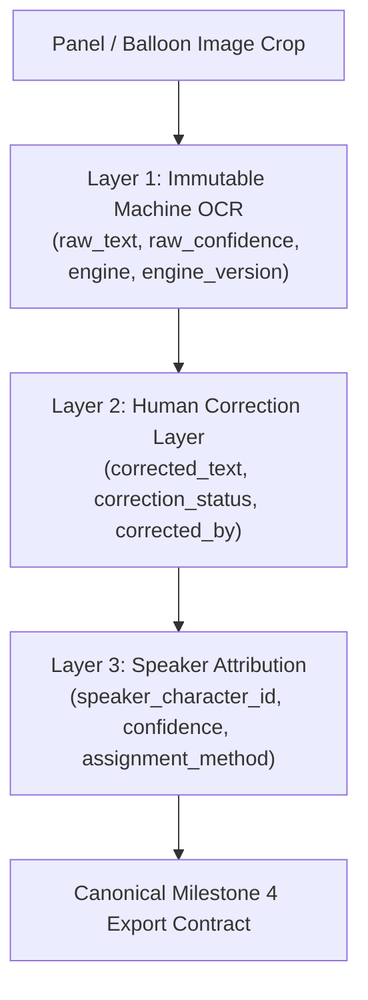

# Text Region Architecture & Data Model

PanelFlow Studio implements a formal **Text Region Subsystem** that bridges panel segmentation and character-level dialogue adaptation. Rather than treating an entire panel as a single monolithic OCR block, PanelFlow decomposes panels into localized, ordered text regions.

---

## 1. Core Domain Model (`TextRegionRecord`)

Every detected or user-drawn speech balloon, narration box, or sound effect is persisted as an independent `TextRegionRecord` in SQLite (WAL mode).

### Coordinate Spaces

Each text region stores coordinates in both **panel-relative** and **page-absolute** coordinate spaces:

| Field | Coordinate Space | Description |
|---|---|---|
| `x`, `y` | Panel-Relative (px) | Top-left offset relative to the cropped panel image. |
| `width`, `height` | Panel-Relative (px) | Pixel dimensions within the panel crop. |
| `normalized_x`, `normalized_y` | Normalized (0.0 – 1.0) | `x / panel_width`, `y / panel_height` for zoom/resolution independence. |
| `normalized_width`, `normalized_height` | Normalized (0.0 – 1.0) | `width / panel_width`, `height / panel_height`. |
| `page_x`, `page_y` | Page-Absolute (px) | Global coordinates on the original normalized page canvas (`panel.x + region.x`). |
| `page_width`, `page_height` | Page-Absolute (px) | Dimensions on the page canvas. |

### Ordering Fields

- `sequence_in_panel`: Sequence (1..N) within the enclosing panel, determined by reading direction (`ltr`, `rtl`, `vertical`).
- `sequence_global`: Monotonically increasing sequence across the entire comic project.

---

## 2. Text Region Classifications

| Classification | Visual Characteristics | Typical Content |
|---|---|---|
| `SPEECH` | Elliptical or rounded high-whiteness contour, optional tail pointing to speaker. | Spoken dialogue between characters. |
| `NARRATION` | Sharp rectangular or rounded rectangle box, often borderless or colored background. | Omniscient narrator, time-skip cues ("Meanwhile..."). |
| `THOUGHT` | Cloud-like scalloped borders or bubbles trailing to character's head. | Internal monologue, unspoken feelings. |
| `SFX` | Dynamic stylized typography, non-standard aspect ratio, integrated into line art. | Sound effects ("BAM!", "CRASH", "SWOOSH"). |
| `CAPTION` | Floating rectangular caption, subtitle, or location card. | Scene setting ("Sector 7G, Earth Orbit"). |
| `UNKNOWN` | Ambiguous text cluster, fallback full-panel bounding box. | Unclassified text, requires human review. |

---

## 3. The 3-Layer Architecture

PanelFlow enforces strict layer separation to guarantee provenance and prevent automated hallucinations from contaminating human corrections.



### Layer 1: Immutable Machine OCR (Machine Provenance)
- **Fields**: `raw_text`, `raw_confidence`, `raw_polygon`, `ocr_engine`, `ocr_engine_version`, `ocr_extracted_at`.
- **Constraint**: Strictly read-only once written by the OCR engine. Never mutated by human edits or LLM transformations. Provides verifiable provenance.

### Layer 2: Human Correction Layer (Canonical Content)
- **Fields**: `corrected_text`, `corrected_by`, `correction_status` (`UNEDITED`, `EDITED`, `VERIFIED`), `corrected_at`.
- **Constraint**: Defaults to `raw_text`. When an editor modifies text in the UI, `corrected_text` stores the approved version while Layer 1 remains untouched.

### Layer 3: Speaker Attribution Preparation (Downstream Ready)
- **Fields**: `speaker_character_id`, `speaker_confidence`, `speaker_assignment_method` (`MANUAL`, `RULE_TAIL`, `PROXIMITY`, `LLM_INFERRED`).
- **Constraint**: Prepared for Milestone 4 character registry without baking in hardcoded character names.

---

## 4. Detection Pipeline (`ClassicalTextRegionDetector`)

1. **Morphological Speech Balloon Extraction**:
   - Converts panel crop to grayscale and applies adaptive Otsu thresholding.
   - Computes whiteness masks (brightness $\ge 225$) to isolate high-luminance speech balloons.
   - Finds connected components with area $\ge 0.008$ of panel area and circularity/solidity filters.
2. **Narration Box Isolation**:
   - Detects high-aspect-ratio rectangular boxes with dark outlines and high interior uniformity.
3. **Sound Effect & Text Stroke Grouping**:
   - Runs morphological dilation ($3 \times 15$ kernels) to bridge adjacent letter strokes into coherent text blocks.
4. **Guaranteed Fallback**:
   - If no distinct balloons are isolated, generates an `UNKNOWN` region covering the panel center with `status="NEEDS_REVIEW"`, ensuring zero dropped dialogue.

---

## 5. Canonical Downstream JSON Contract

When the project reaches `OCR_APPROVED`, the canonical export endpoint (`/api/projects/{project_id}/export/contract`) produces the structured schema required by Milestone 4:

```json
{
  "project_id": "proj_12345",
  "title": "Cosmic Chronicles Chapter 1",
  "current_stage": "OCR_APPROVED",
  "rights": {
    "status": "PUBLIC_DOMAIN",
    "license_info": "Public Domain Mark 1.0"
  },
  "exported_at": "2026-10-17T08:54:00Z",
  "pages": [...],
  "panels": [
    {
      "id": "pan_001",
      "sequence_global": 1,
      "sequence_page": 1,
      "bbox": [80, 120, 840, 600],
      "normalized_bbox": [0.0667, 0.0667, 0.7000, 0.3333],
      "reading_direction": "ltr",
      "panel_type": "STANDARD",
      "status": "CONFIRMED"
    }
  ],
  "text_regions": [
    {
      "id": "tr_001",
      "panel_id": "pan_001",
      "sequence_in_panel": 1,
      "sequence_global": 1,
      "bbox": [50, 40, 220, 110],
      "normalized_bbox": [0.0595, 0.0667, 0.2619, 0.1833],
      "page_bbox": [130, 160, 220, 110],
      "region_type": "SPEECH",
      "status": "CONFIRMED",
      "detection_method": "AUTO",
      "raw_ocr": {
        "text": "Greetings, traveler of the cosmos!",
        "confidence": 0.96,
        "engine": "mock_ocr",
        "engine_version": "1.0",
        "extracted_at": "2026-10-17T08:54:10Z"
      },
      "corrected_text": {
        "text": "Greetings, traveler of the cosmos!",
        "corrected_by": "HUMAN_OPERATOR",
        "status": "VERIFIED",
        "corrected_at": "2026-10-17T08:54:15Z"
      },
      "speaker": {
        "character_id": "char_navigator_01",
        "confidence": 0.95,
        "assignment_method": "RULE_TAIL"
      }
    }
  ]
}
```
