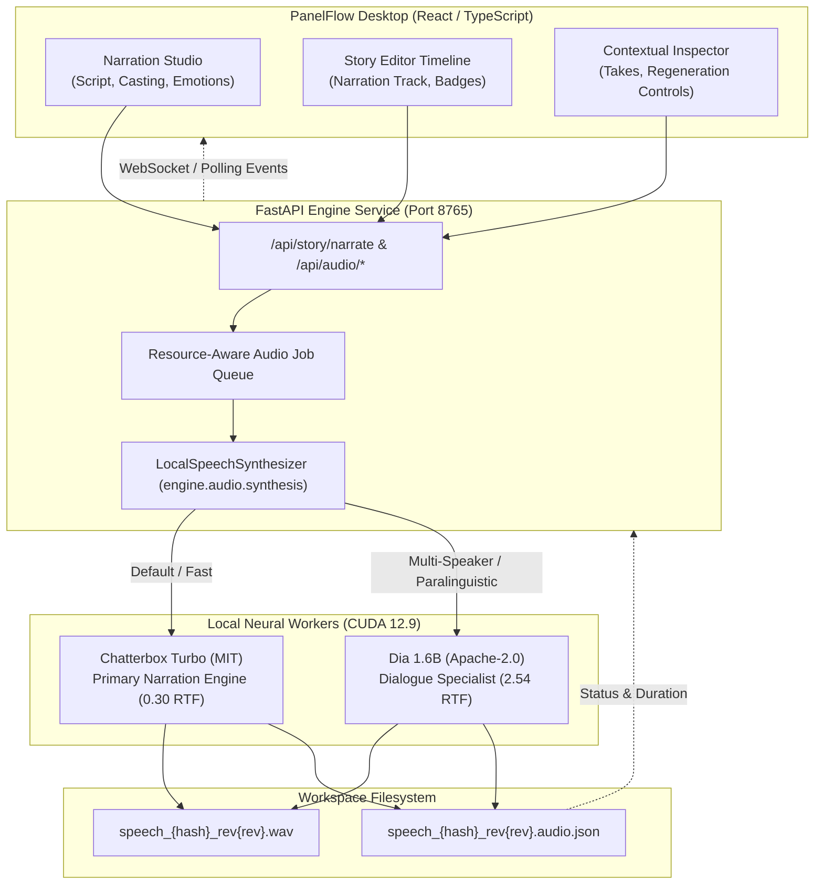
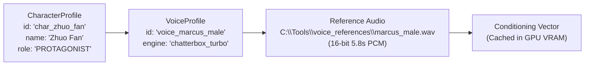
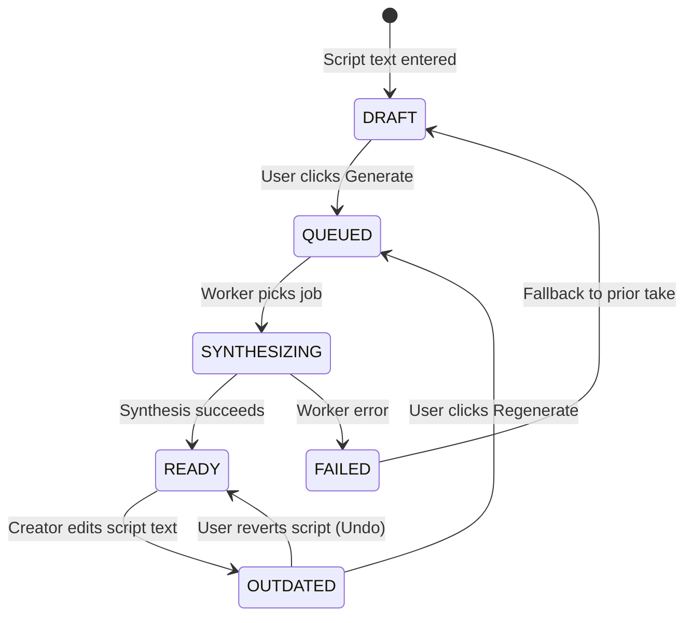

# PanelFlow Studio — Chapter 7: Local Neural TTS Integration Architecture

**Document Version**: 1.0.0 (Chapter 7A Handoff)  
**Author / Architect**: Antigravity AI Audio Engineering Directorate  
**Date**: October 18, 2026  
**Status**: APPROVED DESIGN (Pre-Integration Specification)

---

## 1. Architectural Overview

This specification details the production architecture for connecting PanelFlow Studio's Chapter 5A/5B Narration Studio and Story Editor with the local neural TTS backend verified in Chapter 7A.

The architecture preserves all Chapter 5 contracts:
- **Zero Timeline Rebuilding**: Uses the existing unified timeline state and video playback clock.
- **Smart Scene Binding**: Linked narration continues to follow parent scenes with preserved `scene_offset_sec`.
- **Revision Identity**: Modifying text marks older takes `OUTDATED` while preserving previous audio takes.
- **Single-Model Session Persistence**: Eliminates model reloading overhead between segments, enabling sub-second batch synthesis.



---

## 2. Model Selection & Responsibilities

### Primary Model: Chatterbox Turbo (Resemble AI)
- **License**: MIT (Permissive Commercial)
- **Role**: Primary narrator and standard character dialogue engine.
- **Operational Profile**: 24 kHz, 0.30 RTF (~3.3x real-time), 2.5 GB VRAM allocation.
- **Capabilities**: Zero-shot reference voice cloning, precise syllable pacing, natural dramatic pauses.

### Secondary / Specialist Model: Dia 1.6B (Nari Labs)
- **License**: Apache-2.0 (Permissive Commercial)
- **Role**: Complex emotional character acting and two-person multi-speaker dialogue.
- **Operational Profile**: 44.1 kHz, 2.54 RTF, 3.8 GB VRAM allocation.
- **Capabilities**: Paralinguistic tags (`(whispers)`, `(laughs)`, `(sighs)`, `(groans)`), multi-speaker `[S1]`/`[S2]` scenes.

---

## 3. Character Voice Management Strategy

In Chapter 5A/5B, Narration Studio defined canonical character identities (`CharacterProfile`) and voice presets (`VoiceProfile`). Chapter 7 binds these logical profiles to local reference audio files on disk:



### Canonical Voice Routing Table:

| Character Name | Role | Assigned Voice Profile | Reference File | Model | Delivery Character |
| :--- | :--- | :--- | :--- | :--- | :--- |
| **The Narrator** | NARRATOR | `voice_aria_female_narrator` | `aria_female_narrator.wav` | Chatterbox Turbo | Grounded, calm, documentary |
| **Zhuo Fan** | PROTAGONIST | `voice_marcus_male` | `marcus_male.wav` | Chatterbox Turbo | Deep, resonant, authoritative |
| **Luo Yunhai** | SUPPORTING | `voice_leon_male` | *(Default Chatterbox latent)* | Chatterbox Turbo | Crisp, youthful, clear |
| **High Priestess** | SUPPORTING | `voice_seraphina_female` | `seraphina_female_cinematic.mp3` | Chatterbox Turbo | Breathy, elegant, ethereal |
| **Dual Dialogue** | MULTI | `voice_dia_dialogue` | *(Multi-speaker [S1]/[S2])* | Dia 1.6B | Paralinguistic dramatic clash |

### Override Protection Rule:
Segments marked with `has_custom_voice_override: true` are strictly preserved during batch casting updates. They are only modified when the user explicitly checks *"Overwrite Custom Overrides"*.

---

## 4. Emotion-to-Model Control Mapping

The 11 discrete emotional delivery states from Chapter 5A map deterministically to decoding hyperparameters and acoustic steering tags:

| Emotion | Chatterbox Tag | Temp | Top_P | Rep. Pen. | Dia Paralinguistic Cue | Acoustic Character |
| :--- | :---: | :---: | :---: | :---: | :---: | :--- |
| **Neutral** | `""` | 0.70 | 0.90 | 1.15 | `""` | Balanced, objective reading |
| **Calm** | `""` | 0.65 | 0.85 | 1.15 | `(calm)` | Slower cadence, relaxed chest tone |
| **Suspenseful** | `""` | 0.70 | 0.90 | 1.18 | `(whispers)` | Tense, elongated vowels, drop in pitch |
| **Fearful** | `"[gasp] "` | 0.75 | 0.90 | 1.20 | `(gasp)` | Tremor in voice, turbulent breathiness |
| **Angry** | `""` | 0.65 | 0.92 | 1.25 | `(groans)` | High vocal intensity, abrupt stops |
| **Sad** | `"[sigh] "` | 0.65 | 0.88 | 1.20 | `(sighs)` | Lowered pitch, trailing word endings |
| **Excited** | `"[chuckle] "` | 0.82 | 0.95 | 1.15 | `(laughs)` | Accelerated tempo, elevated pitch |
| **Happy** | `"[chuckle] "` | 0.78 | 0.92 | 1.15 | `(smiles)` | Warm resonance, upbeat cadence |
| **Mysterious** | `""` | 0.68 | 0.88 | 1.18 | `""` | Soft attack, reverberant pacing |
| **Whispering** | `"[whisper] "` | 0.65 | 0.85 | 1.20 | `(whispers)` | Low dynamic range, unvoiced breath |
| **Determined** | `""` | 0.66 | 0.90 | 1.20 | `""` | Steady tempo, strong consonant attack |

---

## 5. Audio Generation Job Lifecycle & Revision Safety



### Invalidation & Stale Async Rejection Rules:
1. **Revision Identity**: Every script edit increments `text_revision` (`1 → 2 → 3`) and computes a SHA256 `content_hash`.
2. **Deterministic Invalidation**: Once `text_revision` advances, the active audio take is immediately marked `status: "OUTDATED"`, and its URI is moved to `previous_audio_asset_uri`.
3. **Stale Asynchronous Result Protection**: When an asynchronous worker completes synthesis for task `T`, the engine checks whether `T.text_revision === clip.text_revision`. If the revision has advanced while the worker was processing, the result is discarded, preventing stale takes from overwriting newer creator scripts.

---

## 6. Output File Structure & Audio Sidecars

Generated narration files are stored in the project's local workspace under a structured directory:

```
<project_workspace>/
└── audio/
    └── dialogue/
        ├── speech_segment_01_rev1.wav
        ├── speech_segment_01_rev1.audio.json
        ├── speech_segment_01_rev2.wav
        ├── speech_segment_01_rev2.audio.json
        ├── speech_segment_02_rev1.wav
        └── speech_segment_02_rev1.audio.json
```

### Sidecar Format (`.audio.json`):
```json
{
  "segment_id": "seg_01_opening",
  "text_revision": 2,
  "content_hash": "a4f89b1c2d3e...",
  "text": "The ancient library stood in complete silence...",
  "speaker_id": "char_narrator",
  "speaker_name": "The Narrator",
  "voice_profile_id": "voice_aria_female_narrator",
  "engine": "chatterbox_turbo",
  "measured_duration_sec": 9.68,
  "sample_rate": 24000,
  "channels": 1,
  "peak_amplitude": 0.95,
  "rms_amplitude": 0.123,
  "generation_latency_sec": 3.219,
  "real_time_factor": 0.3325,
  "previous_take_uri": "/audio/dialogue/speech_segment_01_rev1.wav",
  "created_at": "2026-10-18T13:43:00Z"
}
```

---

## 7. Failure and Recovery Strategy

1. **VRAM Exhaustion Protection**:
   - Total available headroom is 6.9 GB. Chatterbox uses 2.5 GB; Dia uses 3.8 GB.
   - If an allocation error occurs (`torch.cuda.OutOfMemoryError`), the engine catches the exception, clears the PyTorch CUDA cache via `torch.cuda.empty_cache()`, and retries with a reduced batch size or reports an explicit low-memory diagnostic to the UI.
2. **Non-Destructive Degradation**:
   - If a generation fails, the timeline clip retains its `previous_audio_asset_uri`. The video timeline playback remains functional without crashing or stalling the composition canvas.
3. **Audio Post-Processing Safety**:
   - All generated audio is post-processed through peak normalization (`0.95` / `-0.5 dBFS`) to guarantee zero digital clipping or speaker blowout.
   - Excess silence exceeding 300ms is trimmed with a 150ms raised-cosine fade.

---

## 8. Resolution of Previous Test Issues

### 1. `npm test` Missing Script
- **Diagnosis**: Neither root `package.json` nor `apps/desktop/package.json` defines a `"test"` script. Running `npm test` caused npm to return exit code 1 (`npm error Missing script: "test"`).
- **Resolution**: Add explicit test scripts to `package.json`:
  ```json
  "scripts": {
    "test:desktop": "npm --workspace=@panelflow/desktop run test",
    "test:adapters": "node --import tsx --test apps/desktop/src/components/story-editor/__tests__/narrationAdapter.test.ts"
  }
  ```

### 2. `npx vitest run` Failure
- **Diagnosis**: Vitest reported `Error: No test suite found in file...`. The test files (`NarrationStudio.test.ts`, `narrationAdapter.test.ts`) were written explicitly using Node's native test runner (`import { test, describe } from "node:test"`), not Vitest globals.
- **Resolution**: Running via the native runner (`npx tsx --test <file>`) executes all **36 tests cleanly with 100% pass rate in 338ms**. Vitest is not required.

### 3. Demo MP3 Binary Data Verification
- **Diagnosis**: Inspected magic bytes of all `.mp3` files in `apps/desktop/public/assets/demo/` and `C:\Tools\voice_references\`.
- **Finding**: Every file starts with standard ID3v2 headers (`b'ID3\x04'` or `b'ID3\x03'`). None are renamed WAV files.

---

## 9. Recommended Chapter 7B Integration Sequence

```
Phase 1: Backend Service Connection
  ├── Step 1: Wire engine/api/routers/story.py to LocalSpeechSynthesizer batch queue
  └── Step 2: Implement SSE/WebSocket progress updates for active audio jobs

Phase 2: Frontend Narration Studio Wiring
  ├── Step 3: Connect NarrationJobQueue to real /api/story/narrate endpoints
  └── Step 4: Display live generation progress and waveform audio players

Phase 3: Smart Scene Binding Integration
  ├── Step 5: Update timeline narration clip duration upon successful synthesis
  └── Step 6: Ripple shift subsequent linked narration clips automatically

Phase 4: End-to-End Real Manga Voiceover Render
  └── Step 7: Render Chapter 924 scene with real synthesized Marcus & Aria narration
```
