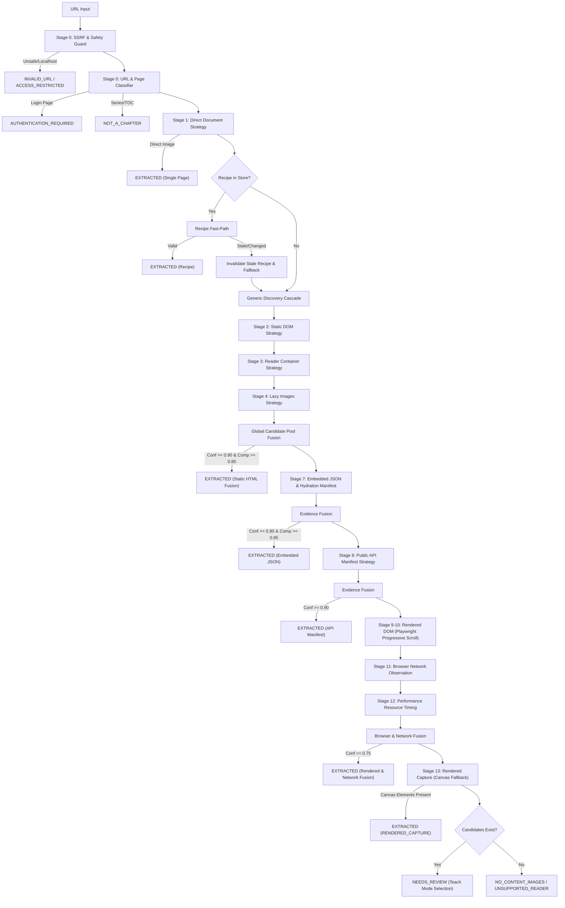

# PanelFlow Studio — Adaptive Resilient Chapter Extraction Engine

## 1. Vision & Architecture

The **Adaptive Resilient Chapter Extraction Engine** is a local-first, multi-strategy discovery and evidence-fusion subsystem designed to convert arbitrary authorized web comic, manga, manhwa, manhua, and webtoon chapters into structured `ChapterManifest`s.

The engine strictly rejects site-specific hardcoding in favor of **generic structural discovery**, **explainable candidate scoring**, **multi-source evidence fusion**, and **self-healing reader recipes**.

---

## 2. Extraction Ladder (Cost & Execution Order)

The engine traverses strategies in strict order from **cheapest (HTTP static)** to **most expensive (headless browser / canvas capture)**, exiting as early as high confidence and completeness thresholds are satisfied:

---

## 3. Core Architectural Subsystems

1. **`GlobalCandidatePool`**: Unifies observations of candidates across Static DOM, Rendered DOM, Network events, and Resource Timings. Prevents duplicate extraction while amplifying multi-source confidence.
2. **`CandidateClusterer`**: Organizes image candidates by CDN host, URL path parent, and DOM container. Discovers the dominant chapter cluster while filtering thumbnails, sidebar covers, and user avatars.
3. **`CandidateScorer`**: Evaluates individual candidates with explainable positive (large dimensions, comic aspect ratios, reader container, dominant cluster) and negative (thumbnails, ads, navigation, micro-dimensions) signals.
4. **`SequenceResolver`**: Enforces deterministic natural numeric ordering (e.g. `1, 2, ..., 9, 10, 11`), preventing alphabetical sort anomalies (`1, 10, 11, 2`).
5. **`ChapterValidator` & `ImageProbe`**: Verifies magic bytes (`\xff\xd8\xff`, `\x89PNG`, `RIFF...WEBP`), rejects HTML error pages masquerading as images, guards against decompression bombs, and calculates cryptographic SHA-256 hashes.
6. **`ResumableChapterDownloader`**: Supports bounded concurrency, domain rate-limiting, and resume functionality. Skips already-downloaded valid files upon application restart.
