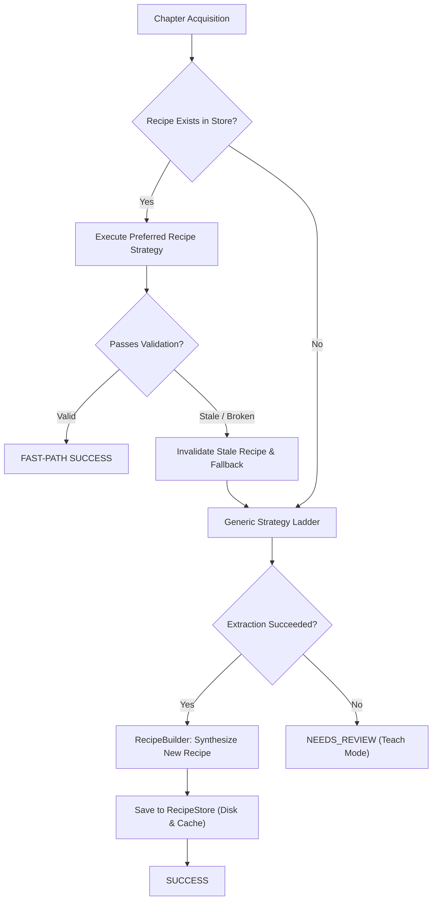

# PanelFlow Studio — Self-Healing Reader Recipe Architecture

## 1. Overview

A **ReaderRecipe** stores structural knowledge about how a specific comic domain renders chapters. Rather than relying on a single brittle CSS selector, a recipe encapsulates a robust structural fingerprint:

```json
{
  "domain": "example-manga.org",
  "chapter_path_pattern": "/series/*/chapter-*",
  "preferred_strategy": "STATIC_DOM",
  "container_signatures": ["div.chapter-content", "article.reader"],
  "image_attributes": ["data-src", "data-original", "src"],
  "ordering": "DOM_ORDER",
  "expected_cluster_minimum": 5,
  "known_cdn_patterns": ["cdn.example-manga.org"],
  "version": 1
}
```

---

## 2. Recipe Lifecycle



---

## 3. Fast-Path Optimization
When an authorized user queues 50 chapters of a series:
- **Chapter 1**: Traverses the generic discovery ladder, identifies the dominant reader container and lazy image attributes, and generates a `ReaderRecipe`.
- **Chapters 2–50**: Instantly matches the recipe, invokes `FAST-PATH`, bypasses expensive DOM heuristics or browser rendering, and extracts chapters in milliseconds.

---

## 4. Self-Healing Mechanism
Websites periodically update their frontend layouts, rotate CDN domain names, or migrate to new reader wrappers.

When a cached recipe runs on an updated page:
1. `RecipeValidator` tests candidate count against `expected_cluster_minimum` and verifies CDN patterns.
2. If candidates are insufficient or CDN patterns mismatch, the validator declares the recipe **STALE**.
3. The orchestrator immediately **purges the stale recipe** from `RecipeStore` without failing the user request.
4. The generic discovery cascade executes automatically (e.g. falling back to `RENDERED_DOM` or `BROWSER_NETWORK`).
5. Upon successful extraction, `RecipeBuilder` synthesizes an **updated recipe** reflecting the site's new layout and saves it to disk.
