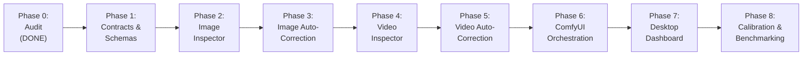

# Visual Quality Inspector & Auto-Correction Implementation Roadmap

**Date of Audit**: 2026-11-19  
**Execution Status**: Planning & Technical Discovery Only. Implementation on hold pending explicit owner approval.

---

## 1. Phased Development Roadmap

The implementation plan is structured into 9 modular phases designed to deliver immediate incremental value while respecting system stability and hardware boundaries.

---

### Phase 0 — Environment & Capability Audit (COMPLETED)
- **Goal**: Physical audit of drives, environments, models, custom nodes, workflows, and hardware constraints.
- **Deliverables**: Reports 1 through 10 in `docs/quality_inspector/`.
- **Status**: **100% COMPLETE**.

---

### Phase 1 — System Architecture, Contracts & Core Interfaces
- **Goal**: Define canonical Pydantic data schemas, defect categories, REST API routes, and configuration boundaries.
- **Tasks**:
  1. Define `DefectRecord`, `QualityDecision`, and `InspectorConfig` models in `engine/inspector/schema.py`.
  2. Implement `QualityDecisionEngine` scoring formula ($Score = 100 - \sum \text{DefectPenalty}_i$).
  3. Define error handling contracts and persistence format for `quality_audit.jsonl`.
- **Dependencies**: Pydantic 2.14, Python 3.14.
- **Reusable Components**: `engine/original/anatomy/rules.py` (`Defect`), `engine/original/anatomy/review.py` (`AnatomyReport`).
- **New Components**: `engine/inspector/schema.py`, `engine/inspector/decision.py`.
- **Risks**: Overly complex schema hierarchies slowing down serialization.
- **Acceptance Criteria**: Unit tests validating serialization, validation rules, and score calculation across 20 synthetic edge cases.
- **Estimated Complexity**: **Low** (pure Python, 0 model dependencies).

---

### Phase 2 — Image-Level Visual Quality Inspector
- **Goal**: Deliver a unified image defect analyzer combining DWPose keypoint topology, YOLOv8/InsightFace face analysis, and multi-tile VLM enumeration.
- **Tasks**:
  1. Integrate `DWPoseExtractor` to extract 133-keypoints from generated image arrays.
  2. Implement `SkeletonTopologyValidator` (joint angle anomalies, extra limb detection, inverted elbows/knees).
  3. Implement `FaceIntegrityAnalyzer` (YOLOv8 face count vs person count; InsightFace intra-frame duplicate face clustering).
  4. Connect existing multi-tile VLM enumeration (`engine/original/anatomy/`) for stray text and doubled objects.
  5. Combine all outputs into `QualityDecision` (`PASS`, `RETRY`, `MANUAL REVIEW`).
- **Dependencies**: Phase 1 schemas; `dw-ll_ucoco_384.onnx`, `yolox_l.onnx`, `face_yolov8m.pt`, `antelopev2`, Ollama `qwen3.5:9b`.
- **Reusable Components**: `dwpose_extractor.py`, `questions.py`, `tiles.py`, `rules.py`, `judges.py`.
- **New Components**: `engine/inspector/image_inspector.py`, `engine/inspector/topology.py`, `engine/inspector/face_check.py`.
- **Risks**: VLM latency (4–8 s); false-positive face matches on identical twin characters.
- **Acceptance Criteria**: Demonstrates 100% recall on the 14 known defect images in `tests/data/anatomy_labels.json` with 0 false alarms on 15 clean images.
- **Estimated Complexity**: **Moderate**.

---

### Phase 3 — Image Auto-Correction & Revalidation
- **Goal**: Implement automatic localized inpainting for repairable defects, with fallback to global seed-stepped redraw and full revalidation.
- **Tasks**:
  1. Implement `DefectMaskGenerator`: Generates 8-bit feathered PNG masks around defect coordinates (dilated convex hull around anomalous joints or face boxes).
  2. Implement `ImageInpaintPatcher`: Connects to ComfyUI's `anime_sdxl_inpaint.api.json` with `animagine-xl-4.0.safetensors`.
  3. Implement `RevalidationLoop`: Re-inspects the repaired image using Phase 2 Inspector; verifies defect resolution and absence of new artifacts.
  4. Fallback handler: If inpainting fails or defect is structural (merged bodies), triggers global redraw (`seed + 7919`) with learned prompt lessons (`engine/original/anatomy/lessons.py`).
- **Dependencies**: Phase 2 Inspector; ComfyUI API on port 8188; `anime_sdxl_inpaint.api.json`.
- **Reusable Components**: `engine/comfyui/art.py` (`ArtEngine.run`), `engine/original/anatomy/loop.py` (`generate_checked`), `lessons.py`.
- **New Components**: `engine/inspector/mask_gen.py`, `engine/inspector/repair.py`.
- **Risks**: Inpainting seam lines if denoise is misaligned; style clash if repairing a HiDream transformer image with SDXL inpainter.
- **Acceptance Criteria**: Successfully repairs at least 1 known defect image (e.g. extra hand) resulting in a `PASS` rating on the revalidation pass without user intervention.
- **Estimated Complexity**: **Moderate to High**.

---

### Phase 4 — Video Quality Inspector
- **Goal**: Extend inspection to temporal video sequences: keypoint velocity jitter, character identity drift, face stability, and scene transition integrity.
- **Tasks**:
  1. Implement `VideoFrameSampler`: Extracts frames at keyframe intervals (e.g., 4 fps or shot boundaries) via OpenCV.
  2. Implement `TemporalKeypointTracker`: Uses `DWPoseExtractor.extract_video_stream` to calculate frame-to-frame joint velocity; flags teleporting limbs ($>3\sigma$ acceleration).
  3. Implement `CharacterIdentityDriftTracker`: Extracts 512-dim ArcFace / CLIP embeddings per frame; detects identity drift when cosine similarity drops below 0.65.
  4. Implement `PhotometricFlickerDetector`: Measures high-frequency luminance variation across stabilized crops.
  5. Gate analysis using `detect_scenes_opencv` so scene cuts are not flagged as motion defects.
- **Dependencies**: Phase 2 Inspector; OpenCV 5.0, PyAV 19.0; `engine/anime/scene_detector.py`.
- **Reusable Components**: `dwpose_extractor.py`, `scene_detector.py`, `ComfyUI-H3-FaceRefine\nodes.py` (`_embed_faces`).
- **New Components**: `engine/inspector/video_inspector.py`, `engine/inspector/temporal.py`.
- **Risks**: Video processing runtime; handling fast intentional action/camera movement without false alarms.
- **Acceptance Criteria**: Detects artificially introduced face drift and missing-frame limb glitches across a 5-second test video clip.
- **Estimated Complexity**: **High**.

---

### Phase 5 — Video Auto-Correction
- **Goal**: Repair video defects through face re-stabilization stitching, damaged keyframe replacement, or shot-level regeneration.
- **Tasks**:
  1. Wire `ComfyUI-H3-FaceRefine` (`H3FaceTrackCrop`, `H3FaceStitch`) for face-level stabilization and distortion removal.
  2. Implement `KeyframeInpaintAndInterpolate`: For isolated 1–2 frame limb glitches, inpaint the defective frame and re-interpolate motion using `Herrgotts-H3-Infinite` latent stitch.
  3. Shot Redraw Fallback: For severe temporal breakdown, re-render the individual shot (2.5–4.5s) using `ArtEngine` and Wan 2.1 / FastH3.
- **Dependencies**: Phase 4 Video Inspector; ComfyUI video workflows.
- **Reusable Components**: `ComfyUI-H3-FaceRefine`, `Herrgotts-H3-Infinite-Continuation-Suite`, `engine/anime/scene_detector.py`.
- **New Components**: `engine/inspector/video_repair.py`.
- **Risks**: Video encoding latency; subtle boundary pops between repaired and untouched frames.
- **Acceptance Criteria**: Successfully eliminates face flickering or extra limb appearance in a 3-second generated video clip.
- **Estimated Complexity**: **High**.

---

### Phase 6 — ComfyUI Engine Integration & Job Manager Dispatch
- **Goal**: Seamlessly bind the Inspector into PanelFlow's production pipeline and ComfyUI job queue.
- **Tasks**:
  1. Add Inspector hooks into `ArtEngine.generate` (configurable via `PANELFLOW_QUALITY_CHECK=1`).
  2. Integrate with `engine/jobs` to ensure inspection and inpainting jobs respect GPU VRAM locks.
  3. Expose REST endpoints in PanelFlow API (`GET /api/inspector/status`, `POST /api/inspector/inspect`, `POST /api/inspector/repair`).
- **Dependencies**: FastAPI, Uvicorn, `engine/jobs/`.
- **Reusable Components**: `engine/comfyui/art.py`, `engine/jobs/job_manager.py`, `engine/api/routers/`.
- **New Components**: `engine/api/routers/inspector.py`.
- **Risks**: Deadlocks in job queue if VRAM arbiter fails to release lock after inpainting.
- **Acceptance Criteria**: End-to-end API call triggers generation -> inspection -> auto-repair -> revalidation without UI lockups.
- **Estimated Complexity**: **Moderate**.

---

### Phase 7 — Visual Quality Inspector Desktop Dashboard
- **Goal**: Deliver a high-clarity React/Tauri desktop interface for visual review, diffing, and manual override.
- **Tasks**:
  1. Build `QualityInspectorScreen.tsx` in `apps/desktop/src/features/inspector/`.
  2. Implement interactive canvas overlay showing defect bounding boxes, confidence scores, and DWPose skeleton toggles.
  3. Implement Side-by-Side A/B Diff viewer (Original vs Corrected).
  4. Provide manual user action buttons: "Approve Output", "Force Inpaint Region", "Redraw with Seed + 1", "Flag False Alarm".
- **Dependencies**: React, TypeScript, Tailwind CSS, Tauri.
- **Reusable Components**: PanelFlow desktop UI layout, `AnimeReviewScreen.tsx`.
- **New Components**: `QualityInspectorScreen.tsx`, `DefectOverlayCanvas.tsx`, `SideBySideDiff.tsx`.
- **Risks**: High-resolution image canvas rendering lag on large 4K storyboards.
- **Acceptance Criteria**: User can load an inspected asset, toggle defect bounding boxes, inspect score breakdown, and click "Approve" or "Retry".
- **Estimated Complexity**: **Moderate**.

---

### Phase 8 — Reliability, Calibration & Performance Optimization
- **Goal**: Full benchmark calibration, regression prevention, latency reduction, and memory profiling.
- **Tasks**:
  1. Expand calibration dataset in `tests/data/anatomy_labels.json` to 100+ multi-style test images (realistic, manga, stickman).
  2. Tune decision thresholds to maintain False Positive Rate $< 2\%$ and Recall $> 95\%$.
  3. Profile memory usage to ensure GPU VRAM peak never exceeds 14.0 GB.
  4. Automate end-to-end regression test suite in `tests/unit/test_quality_inspector.py`.
- **Dependencies**: Pytest, calibration datasets.
- **Reusable Components**: `tools/anatomy/calibrate.py`, `tests/conftest.py`.
- **New Components**: Automated regression test suite.
- **Risks**: Dataset bias toward one art style.
- **Acceptance Criteria**: Automated test suite passes 100% of tests in $< 90$ seconds (using mocked/cached features) and benchmark runs achieve $>95\%$ recall.
- **Estimated Complexity**: **Moderate**.

---

## 2. Complexity & Dependency Factors Summary

| Phase | Core Objective | Primary Risk Factor | Estimated Complexity |
| :---: | :--- | :--- | :---: |
| **Phase 1** | Schemas & Contracts | Schema churn | **Low** |
| **Phase 2** | Image Inspector | VLM latency & prompt tuning | **Moderate** |
| **Phase 3** | Image Inpainting & Revalidation | Style consistency across inpaint boundary | **Moderate to High** |
| **Phase 4** | Video Temporal Inspector | Motion false-alarms during action scenes | **High** |
| **Phase 5** | Video Auto-Correction | Temporal interpolation artifacts | **High** |
| **Phase 6** | Pipeline & API Integration | VRAM concurrency deadlocks | **Moderate** |
| **Phase 7** | Desktop UI Dashboard | Canvas rendering overhead | **Moderate** |
| **Phase 8** | Calibration & Optimization | Dataset diversity & label quality | **Moderate** |
