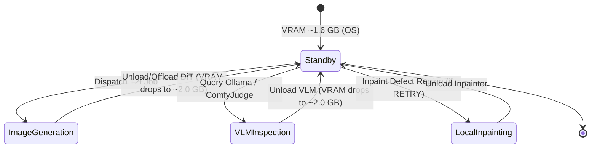

# Model Selection, Hardware Footprint, and Resource Strategy

**Date of Audit**: 2026-11-19  
**Guiding Principle**: Avoid unnecessary downloads. Leverage installed weights. Run vision geometry on CPU to preserve 100% of GPU VRAM for generation and inpainting.

---

## 1. Model Selection & Avoidance Analysis

The user request proposed several potential technologies (Florence-2, SAM2/3, RTMPose/MMPose, OpenPose, InsightFace, Qwen VLM). The physical audit reveals that **most external model downloads can be completely avoided** because superior or equivalent models are already installed on disk.

| Capability Required | Candidate Models in Proposal | Installed Equivalent on Disk | Engineering Decision | Reason for Decision |
| :--- | :--- | :--- | :---: | :--- |
| **Whole-Body & Pose Estimation** | OpenPose, RTMPose, MMPose | `models\dwpose\dw-ll_ucoco_384.onnx` (128 MB) | **AVOID DOWNLOADS. REUSE DWPOSE.** | DWPose outperforms classic OpenPose and RTMPose in accuracy, outputs 133 keypoints (body + hands + face), and is already integrated with ONNX Runtime in `dwpose_extractor.py`. |
| **Person Bounding Box Detection** | YOLOv8-det, Faster-RCNN | `models\dwpose\yolox_l.onnx` (207 MB) | **AVOID DOWNLOADS. REUSE YOLOX-L.** | YOLOX-L is already paired with DWPose, verified, and provides high-recall human detection at 0 MB VRAM. |
| **Face Detection** | MTCNN, RetinaFace, MediaPipe | `models\ultralytics\bbox\face_yolov8m.pt` (50 MB) & SCRFD | **AVOID DOWNLOADS. REUSE YOLOV8M.** | YOLOv8m-face is already verified for both photorealistic and illustrated/anime faces in `ComfyUI-H3-FaceRefine`. |
| **Face Recognition & Identity** | FaceNet, ArcFace, DeepFace | InsightFace `antelopev2\glintr100.onnx` (249 MB) | **AVOID DOWNLOADS. REUSE INSIGHTFACE.** | Antelopev2 Glintr100 is the state-of-the-art ArcFace embedding model, extracting 512-dim vectors for cosine similarity verification. |
| **Non-Photorealistic Character Embeddings** | ResNet, DINOv2 | `models\clip_vision\CLIP-ViT-H-14-laion2B-s32B-b79K.safetensors` | **AVOID DOWNLOADS. REUSE CLIP-VIT-H.** | Installed on disk (2.4 GB). Excellent for stylized manga, anime, and stickman character clustering. |
| **Visual Reasoning & Anomaly Inspection** | Florence-2, BLIP-2, LLaVA | Ollama `qwen3.5:9b` & ComfyUI `Qwen3-VL 8B` | **AVOID FLORENCE-2. REUSE QWEN.** | `qwen3.5:9b` (Q4_K_M) is actively calibrated for multi-tile hand enumeration. Florence-2 is small but lacks the chain-of-thought enumeration required to count fingers/hands accurately. |
| **Image Inpainting Engine** | Stable Diffusion Inpainting 1.5, Repaint | `models\checkpoints\animagine-xl-4.0.safetensors` | **AVOID DOWNLOADS. REUSE SDXL.** | Installed on disk (6.6 GB). High aesthetic score, fully compatible with existing `anime_sdxl_inpaint.api.json` workflow. |
| **Image Segmentation** | SAM2, SAM3, SAM-HQ | Algorithmic Bounding/Hull Mask; `nodes_sam3.py` (awaiting weights) | **USE ALGORITHMIC MASKS INITIALLY.** | Algorithmic dilated hull masks require 0 downloads and 0 MB VRAM. SAM weights can be requested later if pixel-perfect object masks are required. |

---

## 2. Resource Allocation Matrix: CPU vs GPU

A critical breakthrough of this audit is dividing workloads between the **32 GB System CPU RAM** and the **16 GB GPU VRAM**:

```
+-----------------------------------------------------------------------------------+
| HOST SYSTEM RAM (32 GB) - 0 MB VRAM IMPACT                                       |
| - DWPose 133-Keypoint Extraction (ONNX CPU): ~450 MB RAM                          |
| - YOLOX-L Person Detection (ONNX CPU): ~320 MB RAM                                |
| - InsightFace Antelopev2 ArcFace (ONNX CPU): ~380 MB RAM                          |
| - OpenCV Frame Slicing, HSV Scene Detection & SSIM: ~200 MB RAM                   |
| - Deterministic Topology & Sanity Decision Rules: ~50 MB RAM                      |
+-----------------------------------------------------------------------------------+
| GPU VRAM (16,311 MiB Total / ~14,500 MiB Available) - SEQUENTIAL LIFECYCLE        |
| - Generation Phase: HiDream-I1 Fast (~12.5 GB) OR Z-Image Turbo (~7.8 GB)         |
|   -> Generation Finishes -> Model Memory Released to Low/Offload                  |
| - Inspection Phase: Ollama qwen3.5:9b (~6.5 GB) OR Qwen3-VL 8B (~8.5 GB)          |
|   -> Inspection Finishes -> VLM Memory Released                                   |
| - Inpainting Phase (if Defect Found): Animagine XL SDXL Inpaint (~7.5 GB)        |
+-----------------------------------------------------------------------------------+
```

---

## 3. GPU VRAM Sequential Execution Lifecycle

To guarantee **zero Out-of-Memory (OOM) crashes** on the RTX 5060 Ti (16 GB), concurrent GPU execution of generation, VLM inspection, and inpainting is strictly prohibited. The system enforces a **three-stage state machine**:



1. **State 1: Generation**:
   - Model loaded: `hidream_i1_fast_fp8` or `z_image_turbo_int8`.
   - VRAM usage: 7.8–12.5 GB.
   - Outputs generated image to disk/memory.
   - On completion, ComfyUI execution moves to idle.
2. **State 2: Concurrent CPU Feature Extraction (Zero VRAM impact)**:
   - DWPose extracts body, hand, and facial keypoints on CPU.
   - InsightFace computes face embeddings on CPU.
   - Time elapsed: 120–250 ms.
3. **State 3: Semantic VLM Inspection**:
   - Model loaded: Ollama `qwen3.5:9b`.
   - VRAM usage: ~6.5 GB.
   - If dual-witness cross-check is enabled, ComfyJudge (`qwen3vl_8b_int8`) is called.
   - Time elapsed: 4–12 s.
4. **State 4: Localized Inpainting (Only if Defect Confirmed)**:
   - Ollama context freed.
   - ComfyUI executes `anime_sdxl_inpaint.api.json`.
   - Model loaded: `animagine-xl-4.0.safetensors` (~7.5 GB VRAM).
   - Inpainting sampling time: 3.5–5.0 s (28 steps Euler-A).

---

## 4. Model Catalog and Dependency Specifications

### Mandatory Models (All Currently Installed on Disk)

1. **`models\dwpose\dw-ll_ucoco_384.onnx`**
   - Size: 128.2 MB | Runtime: ONNX Runtime CPU | Provider: DWPose (yzd-v).
   - Role: Joint skeleton, hand finger keypoints, facial landmarking.
2. **`models\dwpose\yolox_l.onnx`**
   - Size: 206.7 MB | Runtime: ONNX Runtime CPU | Provider: YOLOX.
   - Role: Human bounding box anchor localization.
3. **`models\ultralytics\bbox\face_yolov8m.pt`**
   - Size: 49.6 MB | Runtime: Ultralytics PyTorch / CPU | Provider: Ultralytics.
   - Role: High-recall face localization across realistic and illustrated domains.
4. **`models\insightface\models\antelopev2\*`**
   - Size: 407.0 MB (5 ONNX models) | Runtime: InsightFace / ONNX Runtime CPU.
   - Role: 512-dim ArcFace identity vectors, 106-point landmarks, 3D face structure.
5. **Ollama `qwen3.5:9b` (Q4_K_M)**
   - Size: 6.55 GB | Runtime: llama.cpp / Ollama Daemon (GPU offload).
   - Role: Multi-tile hand enumeration, text flag detection, pose verification.
6. **`models\checkpoints\animagine-xl-4.0.safetensors`**
   - Size: 6.6 GB | Runtime: ComfyUI SDXL Execution.
   - Role: Localized inpainting engine.

---

### Optional Models (Requiring Explicit Owner Approval Before Any Download)

*Per AGENTS.md rules, these models are NOT installed and will NOT be downloaded without explicit owner consent:*

1. **`sam_vit_b_01ec64.pth` (Segment Anything Model - ViT-B)**:
   - Size: ~375 MB | Source: Meta AI Research.
   - Role: Would provide pixel-perfect contour segmentation masks for non-face objects (clothing tears, stray weapons).
   - *Current Workaround*: Dilated convex hull bounding box masks generated on CPU via OpenCV.
2. **`MobileSAM` (`mobile_sam.pt`)**:
   - Size: ~39 MB | Source: Chaoning Zhang et al.
   - Role: Ultra-lightweight SAM alternative (runs in ~15 ms on CPU).
