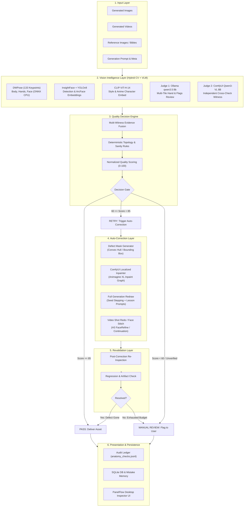
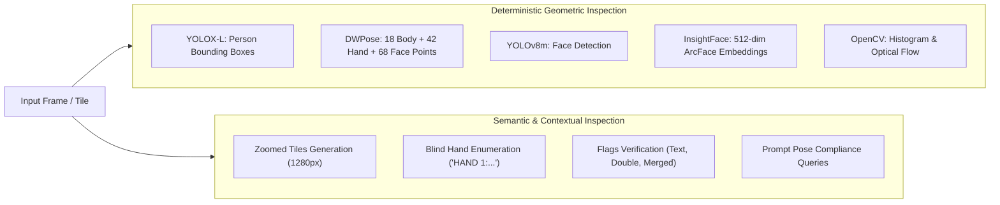
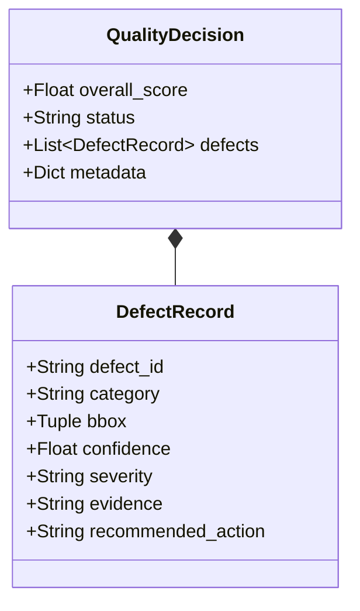
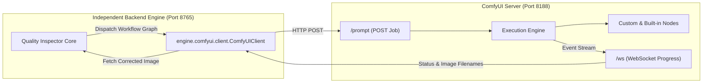

# Proposed System Architecture

**Document Reference**: `PROPOSED_ARCHITECTURE.md`  
**System Name**: Independent AI Visual Quality Inspector and Auto-Correction System  
**Integration Target**: ComfyUI API & PanelFlow Studio Engine

---

## 1. High-Level Architecture Overview

The Visual Quality Inspector is designed as an **independent, modular Python subsystem** that interfaces with ComfyUI via HTTP/WebSocket APIs and with local inference engines (ONNX Runtime, Ollama). It does **not** modify ComfyUI core code, ensuring zero breaking changes to upstream updates.



---

## 2. Detailed Layer Specifications

### Layer A: Input Layer
- **Responsibility**: Ingestion, validation, and metadata normalization for all visual assets.
- **Inputs Handled**:
  - Raw image paths or in-memory PNG/JPEG bytes from ComfyUI outputs.
  - Video streams (MP4/MKV/WebM) from disk or generation jobs.
  - Optional generation prompt strings, negative prompts, and seed values.
  - Optional reference character images (character sheets, front-facing reference portraits).
  - Optional character metadata (expected number of characters, clothing description).
- **Safety Guarantee**: Original assets are marked read-only; all corrections are written to derivative filenames (e.g., `panel_012_corrected_v1.png`).

---

### Layer B: Vision Intelligence Layer (Hybrid CV + Multi-Modal VLM)

To overcome the known blind spots of standalone VLMs (which hallucinate, miss small fingers, or fail at counting), the intelligence layer implements a **tri-modal inspection architecture**:



1. **Deterministic Geometric Track (CPU / ONNX)**:
   - `DWPoseExtractor`: Extracts 133 coordinates. Checks joint connectivity, detects missing arms, measures wrist-to-hand finger integrity, and provides exact pixel bounds for hands.
   - `YOLOv8m + InsightFace`: Locates all faces and generates invariant feature vectors. Enables identity matching and duplicate character detection.
   - *Resource Footprint*: **0 MB VRAM**, executes on host CPU using multi-threading.
2. **Semantic Multi-Tile VLM Track (GPU / Ollama / ComfyUI)**:
   - `OllamaJudge` (`qwen3.5:9b`): Executes blind multi-tile queries. Forces the model to list each visible hand line-by-line rather than guessing numbers.
   - `ComfyJudge` (`Qwen3-VL 8B`): Corroborates suspected defects. A defect is only confirmed if two independent judges agree or if one judge confirms across multiple zoomed tiles.
   - *Resource Footprint*: ~6.5 GB VRAM in sequential execution.

---

### Layer C: Quality Decision Engine

The decision engine aggregates observations across both inspection tracks into a structured defect ledger:



- **Defect Categories**:
  - `extra_hands` / `missing_hand`: Hand line count $> 2 \times \text{person count}$ or DWPose hand disconnection.
  - `extra_limbs`: Anomalous leg/arm keypoint clusters or impossible bone length ratios.
  - `distorted_face` / `missing_face`: Low face confidence, extreme landmark asymmetry, or eye count $\ne 2$.
  - `duplicate_character`: Intra-frame face cosine similarity $> 0.72$ between separated bounding boxes.
  - `extra_head`: Face detector count $>$ Body detector count.
  - `stray_text`: Unsolicited typography, watermarks, or artist signatures.
  - `duplicate_object`: Ghost weapons or doubled items in character grasp.
  - `merged_bodies`: Two overlapping body skeletons with indeterminate limb ownership.
  - `temporal_jitter`: Inter-frame keypoint velocity $> 3\sigma$ or sudden identity divergence.
- **Categorical Decision Logic**:
  - **PASS**: No confirmed defects, composite score $\ge 85$. Output released directly to pipeline.
  - **RETRY / AUTO-CORRECT**: Confirmed localized defect with identifiable bounding box (score 60–84). Triggers Layer D.
  - **MANUAL REVIEW**: High-severity defect (score $< 60$), unresolvable ambiguity, or revalidation failure after maximum budget.

---

### Layer D: Auto-Correction Layer

Depending on the nature and localization of the defect, the system dispatches one of three correction strategies:

```mermaid
flowchart TD
    DECISION{"Defect Nature"} -->|Localized Defect<br/>(Extra Hand, Stray Text, Facial Artifact)| STRAT1["Strategy 1: Localized Inpainting"]
    DECISION{"Defect Nature"} -->|Severe Structural Defect<br/>(Merged Bodies, Wrong Pose)| STRAT2["Strategy 2: Seed-Stepped Redraw"]
    DECISION{"Defect Nature"} -->|Video Temporal Jitter<br/>(Face Distortion, Flicker)| STRAT3["Strategy 3: Video Face Refine / Frame Patch"]

    subgraph STRAT1_FLOW ["Localized Inpainting Pipeline"]
        BBOX["Defect Bounding Box"] --> MASK["Feathered Inpaint Mask (DefectMaskGenerator)"]
        MASK --> COMFY_INP["ComfyUI SDXL Inpaint Graph<br/>(anime_sdxl_inpaint.api.json)"]
        COMFY_INP --> BLEND["ImageCompositeMasked"]
    end

    subgraph STRAT2_FLOW ["Global Redraw Pipeline"]
        LESSON["Extract Lesson Rule<br/>('Exactly two arms, no extra hands')"] --> PROMPT_INJ["Inject into Prompt"]
        PROMPT_INJ --> SEED_STEP["Step Seed (seed + 7919)"]
        SEED_STEP --> ART_GEN["ArtEngine.generate (HiDream / Z-Image)"]
    end

    subgraph STRAT3_FLOW ["Video Temporal Repair"]
        CROP["H3FaceTrackCrop Stabilized Crops"] --> SAM_SMOOTH["H3FaceMaskSAM (Temporally Smoothed)"]
        SAM_SMOOTH --> STITCH["H3FaceStitch Re-Integration"]
    end
```

---

### Layer E: Revalidation Layer

Auto-correction never assumes success. After inpainting or redrawing:
1. The corrected asset is routed back through **Layer B (Vision Intelligence)**.
2. The system checks two distinct criteria:
   - **Resolution Check**: Did the original defect disappear?
   - **Non-Regression Check**: Did the inpainting pass introduce *new* artifacts (e.g., blurred patch, seam lines, doubled objects)?
3. If confirmed clean, the asset transitions to `PASS`. If defects persist and attempts remain within budget (default: 3 retries or 180 seconds), a refined attempt is made. If the budget expires, the cleanest candidate is marked `best_effort` and escalated to `MANUAL REVIEW`.

---

### Layer F: ComfyUI Integration Architecture

The integration operates entirely out-of-process via standard network boundaries:



- **Zero Core Changes**: ComfyUI runs standard `main.py`.
- **Workflow Registry Alignment**: Inpainting graphs are registered in `engine/comfyui/workflow_registry.json` and executed via `ArtEngine.run`.
- **Fault-Tolerant Polling**: In case WebSocket connections drop on Windows, the client falls back to HTTP history polling (`/history/{prompt_id}`).
